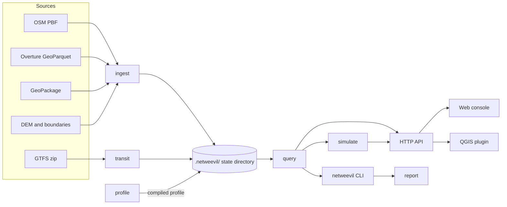

<p align="center">
  
</p>

<h1 align="center">NetWeevil</h1>

<p align="center">
  A local engine for street routing, GTFS transit and traffic analysis on OpenStreetMap data.
</p>

<p align="center">
  <a href="https://elqniemi.github.io/netweevil/"></a>
  <a href="#license"></a>
  
</p>


NetWeevil imports a street network, compiles routing profiles for it and runs
analyses on your computer. You use it through the `netweevil` command, an HTTP
API, a web console or a QGIS plugin. All state stays in one workspace folder.

**Documentation:** <https://elqniemi.github.io/netweevil/>

## Features

- **Street routing**: routes, turn-by-turn directions, waypoints, alternatives,
  trip optimization and map matching of GPS traces.
- **Batch analysis**: origin-destination pairs, travel-time matrices,
  accessibility counts, betweenness and scenario batches.
- **Service areas**: outbound and inbound reach as networks or polygons.
- **Profiles**: YAML profiles for car, bicycle, pedestrian, truck, bus and
  other modes, with turn costs, restrictions and vehicle dimensions.
- **Transit**: GTFS import, scheduled transit routes, transit directions and
  transit reach with walk, bicycle or car access.
- **Traffic**: historical speed sets, live closures and slowdowns, and
  agent-based traffic simulation.
- **Data sources**: OSM PBF, Overture Maps GeoParquet and mapped GeoPackage
  networks, with optional DEM heights and country or state boundaries.
- **3D networks**: multilayer pedestrian networks with stairs, lifts and
  platforms, shown in 3D in the web console.
- **Exact results**: the accelerated engine (CCH) gives the same costs as an
  exact search.

## Architecture



The [architecture page](docs/concepts/architecture.md) describes each crate.

## Quickstart

This procedure imports the Groningen extract and starts the API. You need
Rust 1.96.1 or later. You need Node.js and pnpm to build the web console.

1. Download and filter the Groningen extract. Follow
   [`datasets/README.md`](datasets/README.md).
2. Build the web console. The executable embeds it at build time.

   ```bash
   pnpm --dir frontend install
   pnpm --dir frontend build
   ```

3. Import the dataset:

   ```bash
   cargo run --release -p netweevil-cli -- dataset import \
     datasets/groningen-260508-routing.osm.pbf \
     --name groningen_2026_05
   ```

4. Compile a profile for the dataset:

   ```bash
   cargo run --release -p netweevil-cli -- profile compile \
     --dataset groningen_2026_05 \
     --profile examples/profiles/car_research_v1.yml
   ```

5. Calculate a route. The `.geojson` extension selects the output format.

   ```bash
   cargo run --release -p netweevil-cli -- analyze route \
     --dataset groningen_2026_05 \
     --profile examples/profiles/car_research_v1.yml \
     --request examples/requests/route.json \
     --out .netweevil/runs/example-route.geojson
   ```

6. Start the API:

   ```bash
   cargo run --release -p netweevil-cli -- api serve \
     --dataset groningen_2026_05 \
     --default-profile examples/profiles/car_research_v1.yml
   ```

7. Open the web console at <http://127.0.0.1:8080/>.
8. Open the interactive API reference at <http://127.0.0.1:8080/docs>.

To start without the command line, run `./scripts/start.sh` (macOS and
Linux) or `scripts\start.cmd` (Windows). The console then shows the
**Setup** flow. The [installation guide](docs/getting-started/installation.md)
and the [Docker guide](docs/getting-started/docker.md) give other options.

## Interfaces

| Interface | Use | Documentation |
|---|---|---|
| `netweevil` CLI | Import data, compile profiles, run analyses and benchmarks | [CLI reference](docs/cli/reference.md) |
| HTTP API | Serve one dataset with its profiles and transit feeds. The API serves its OpenAPI document at `/openapi.yaml` and a Swagger UI at `/docs`. | [API guide](docs/api/index.md), [`openapi.yaml`](docs/api/openapi.yaml) |
| Web console | Set up a workspace, run every analysis on a map, edit GTFS scenarios | [Web console](docs/tools/web-console.md) |
| QGIS plugin | Run analyses from QGIS 3.28 to 4.x and load the results as layers | [QGIS plugin](docs/tools/qgis-plugin.md) |

## Documentation

The site at <https://elqniemi.github.io/netweevil/> contains these pages.
The links below open the source files in this repository.

| Section | Pages |
|---|---|
| Getting started | [Installation](docs/getting-started/installation.md), [Quickstart](docs/getting-started/quickstart.md), [Docker](docs/getting-started/docker.md) |
| Concepts | [Architecture](docs/concepts/architecture.md), [State layout](docs/concepts/state-layout.md), [Profiles](docs/concepts/profiles.md), [Routing engine](docs/concepts/routing-engine.md) |
| Street analysis | [Routing](docs/guides/routing.md), [Batch analysis](docs/guides/batch-analysis.md), [Service areas](docs/guides/service-areas.md), [Request profiles](docs/guides/request-profiles.md), [Snap constraints](docs/guides/snap-constraints.md), [Trace matching](docs/guides/trace-matching.md), [Trip optimization](docs/guides/trip-optimization.md) |
| Transit and time | [Transit](docs/guides/transit.md), [Multilayer temporal routing](docs/guides/multilayer-temporal-routing.md), [Traffic](docs/guides/traffic.md), [Simulation](docs/guides/simulation.md) |
| Data | [Datasets](docs/guides/datasets.md), [Regions and elevation](docs/guides/regions-and-elevation.md), [Terrain](docs/guides/terrain.md) |
| Evaluation | [Benchmarking](docs/guides/benchmarking.md), [Reports and experiments](docs/guides/reports-and-experiments.md) |
| Tutorial | [Hong Kong 3D walking and transit](docs/guides/hong-kong-tutorial.md) |
| Tools | [Web console](docs/tools/web-console.md), [QGIS plugin](docs/tools/qgis-plugin.md) |
| Project | [Contributing](CONTRIBUTING.md), [Roadmap](docs/project/roadmap.md), [Changelog](CHANGELOG.md), [Security](SECURITY.md) |

## Repository layout

| Path | Contents |
|---|---|
| `crates/api` | Axum HTTP API, OpenAPI document and Swagger UI page |
| `crates/cli` | The `netweevil` executable |
| `crates/core` | Graph primitives, topology bundles, metrics and acceleration data types |
| `crates/ingest` | OSM, Overture and GeoPackage import, topology build, restrictions and classification |
| `crates/persist` | `.netweevil/` state layout, manifests, binary bundle IO and cache reads |
| `crates/profile` | Profile schema, validation, compilation, turn costs and edge costs |
| `crates/query` | Routing, batches, OD, matrix, service areas, accessibility, alternatives, snapping, and request and result models |
| `crates/report` | Report rendering and local exports |
| `crates/simulate` | Agent-based traffic simulation |
| `crates/transit` | GTFS import, street access and transit routing |
| `frontend/` | React web console that the executable embeds |
| `qgis_plugin/` | QGIS plugin for QGIS 3.28 to 4.x |
| `examples/` | Profiles, requests, API bodies and benchmark corpora. See [`examples/README.md`](examples/README.md). |
| `scripts/` | Start, packaging, data preparation and verification scripts |
| `docs/` | Source of the MkDocs documentation site |
| `datasets/` | Local source files. Only the README is in Git. |

## Reproducibility

The engine is deterministic. The same source extract and the same profile
document give the same result. Each result records the dataset id and the
profile id. Keep the source extract and the profile file to repeat a run.

## Contributing

Read [CONTRIBUTING.md](CONTRIBUTING.md) before you open a pull request. Report
security problems as [SECURITY.md](SECURITY.md) describes. The
[roadmap](docs/project/roadmap.md) lists planned improvements.

## License

The Rust crates, the CLI and API, scripts, examples, Docker configuration,
documentation and repository tooling are available under the
[MIT license](LICENSE-MIT) or the [Apache License 2.0](LICENSE-APACHE), at
your option.

The QGIS plugin in `qgis_plugin/` is available under the MIT license. The
plugin package contains its license text.

OpenStreetMap data is © OpenStreetMap contributors, available under the ODbL.
