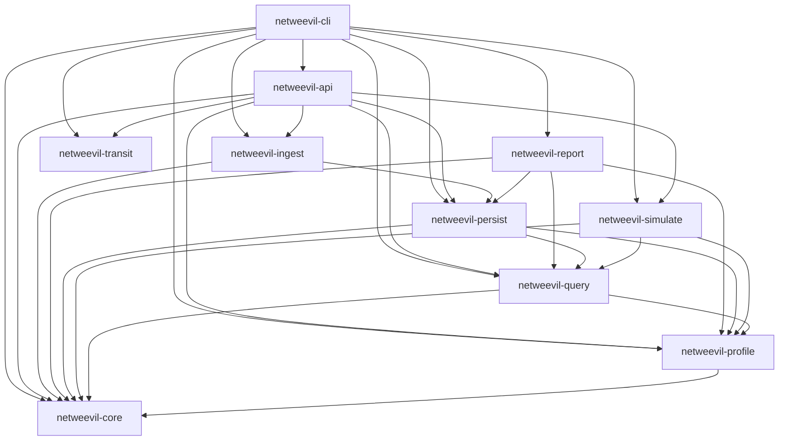
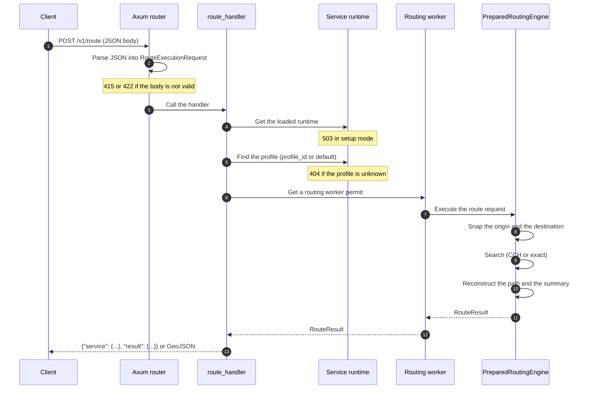

# Architecture

NetWeevil is a Rust workspace. Each crate has one area of responsibility.
The `netweevil` binary and the HTTP API use the same crates. Thus the CLI and
the API give the same result for the same request.

## Crates

| Crate | Package | Responsibility |
| ----- | ------- | -------------- |
| `crates/core` | `netweevil-core` | Graph primitives, topology bundles, metrics and acceleration data types. |
| `crates/profile` | `netweevil-profile` | Profile schema, validation, compilation, turn costs and edge costs. |
| `crates/query` | `netweevil-query` | Routing, batches, OD, matrix, service areas, accessibility, alternatives, snapping, and the request and result models. |
| `crates/persist` | `netweevil-persist` | The `.netweevil/` state directory, manifests, binary bundle IO and cache reads. |
| `crates/ingest` | `netweevil-ingest` | OSM, Overture and GeoPackage import, topology build, turn restrictions, road classification and preprocessing. |
| `crates/transit` | `netweevil-transit` | GTFS import, street access (walk, bicycle, car) and transit routing. |
| `crates/simulate` | `netweevil-simulate` | Agent-based traffic simulation. |
| `crates/report` | `netweevil-report` | Report rendering and local exports. |
| `crates/api` | `netweevil-api` | The Axum HTTP API and the embedded web console. |
| `crates/cli` | `netweevil-cli` | The `netweevil` binary. |

## Crate dependencies

The diagram shows the direct dependencies in the `[dependencies]` section of
each `Cargo.toml` file. An arrow points from a crate to a crate that it
uses. Development dependencies are not shown.



Some properties of the graph:

- `netweevil-core` has no workspace dependencies. All crates except
  `netweevil-transit` use it.
- `netweevil-transit` has no workspace dependencies. The API and the CLI
  connect transit routing to the street network.
- The manifest types are in `netweevil-persist`, in the module
  `netweevil_persist::manifest`.

## Request lifecycle

The diagram shows the steps of a `POST /v1/route` request. The request uses
a profile that the service loaded at start.



1.  The router parses the JSON body. It rejects a body with the wrong
    content type or a body that does not agree with the schema.
2.  The handler gets the service runtime. In setup mode, no runtime is
    loaded and the handler sends `503`.
3.  The handler finds the prepared engine of the profile. A request without
    `profile_id` uses the default profile.
4.  A request with `profile` or `profile_overrides` uses a request-defined
    profile. The service compiles it and keeps the engine in a cache. See
    [Request profiles](../guides/request-profiles.md).
5.  The handler runs the search on a routing worker. The number of workers
    is limited.
6.  The engine snaps the endpoints, searches the graph and reconstructs the
    path. See [Routing engine](routing-engine.md).
7.  The handler puts the result in the response envelope. With
    `?format=geojson`, it sends a GeoJSON `FeatureCollection`.

The response envelope identifies the dataset, the profile and the engine:

```json
{
  "service": {
    "dataset_id": "groningen_2026_05",
    "profile_id": "car_research_v1",
    "route_engine": "...",
    "batch_engine": "...",
    "acceleration": "..."
  },
  "result": { }
}
```

## CLI and API

The CLI command `netweevil analyze route` calls the same engine function as
`POST /v1/route`. For each command, the CLI reads the dataset bundles and
the compiled profile from the state directory. Thus you must compile the
profile with `netweevil profile compile` first. The API loads the dataset and
the profiles one time at start and keeps them in memory.

| Item | CLI | API |
| ---- | --- | --- |
| Dataset | `--dataset <id>` per command | Loaded at start |
| Profile | `--profile <file>` per command | Loaded at start, selected with `profile_id` |
| Request | `--request <file>` | JSON body |
| Result | File given with `--out`, or `.netweevil/runs/<run_id>-result.json` | HTTP response |

## Reproducibility

The engine is deterministic. These inputs fully identify a result:

- The dataset source extract.
- The profile document.
- The request.

The CLI writes a run manifest for each analysis. The manifest records the
dataset id, the profile id, the effective request and the software version.
See [State directory](state-layout.md).
