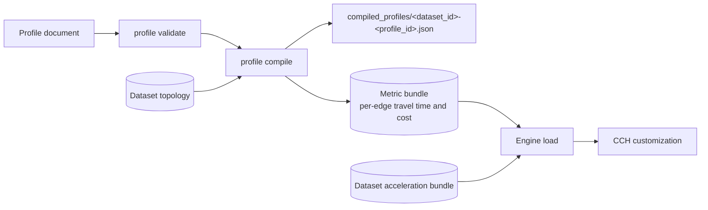

# Profiles

A profile is a document that tells NetWeevil how to move on the street
network. It sets the travel mode, the speeds, the excluded roads, the turn
costs and the cost objective. The same dataset can have many profiles.

A profile is a YAML file (`.yml`, `.yaml`) or a TOML file (`.toml`). The
crate `netweevil-profile` defines the schema in `ProfileDocument`.

## Profile structure

This is a shortened version of `examples/profiles/car_research_v1.yml`:

```yaml
profile:
  id: car_research_v1
  label: "General-purpose car profile"
  mode: car
  defaults_pack: eu_car_2026_01

cost:
  objective: fastest
  distance_weight: 0.0
  time_weight: 1.0

speeds:
  posted_limits: cap

speed_rules:
  - match:
      highway: motorway
    speed_kph: 105
  - match:
      highway: residential
    speed_kph: 35

factors:
  - match:
      surface: cobblestone
    speed_factor: 0.75

turns:
  left_penalty_s: 4
  right_penalty_s: 1
  uturn_penalty_s: 25
  traffic_signal_penalty_s: 6
  roundabout_entry_penalty_s: 2

preferences:
  use_highways: 0.8
  use_tolls: 0.4

returns:
  geometry: full
  segment_rows: true
```

Only the `profile` section is necessary. All other sections have default
values.

## Sections

| Section | Contents |
| ------- | -------- |
| `profile` | The header: `id`, `label`, `mode`, `defaults_pack` and the optional `extends`. |
| `cost` | The `objective` (`fastest`, `shortest` or `generalized`), `distance_weight` and `time_weight`. |
| `speeds` | `posted_limits`: how posted speed limits combine with profile speeds (`prefer`, `cap` or `ignore`). The default is `cap`. |
| `speed_rules` | An ordered list of `match` and `speed_kph`. The first rule that matches an edge sets its speed. |
| `exclude_rules` | A list of `match` blocks. The profile does not use the edges that match. |
| `factors` | A list of `match` and `speed_factor`. NetWeevil multiplies the speed by the factor of each rule that matches. |
| `slope_model` | Optional. Changes the walking speed with the edge gradient. |
| `facilities` | Traversal models for stairs, lifts, escalators and other pedestrian facilities. |
| `components` | Named cost quantities that the result reports next to the main cost. |
| `temporal` | The waiting policy for time-dependent searches. |
| `direction` | Rules for one-way streets for foot and bicycle modes. |
| `turns` | Turn penalties in seconds. |
| `ferry` | Ferry use, boarding cost and default ferry speed. |
| `preferences` | Weights for highways, tolls, tracks and service roads. |
| `vehicle` | Optional. Height, weight, hazmat and other vehicle parameters. Edges with restrictions that the vehicle violates are excluded. |
| `returns` | The default result content: geometry, segment rows and breakdowns. A request can change these values. |

Each `match` block contains one or more attribute keys and values, for
example `highway: residential` or `surface: gravel`. A rule matches an edge
when all its keys match.

### Travel modes

`profile.mode` selects the access rules of the dataset. These values are
available:

| `mode` | Examples |
| ------ | -------- |
| `car` | `car_research_v1.yml`, `ambulance_emergency_call_v1.yml` |
| `bicycle` | `cycling_north_nl_2026_05.yml`, `bicycle_max_grade_osm.yml` |
| `foot` | `pedestrian_research_v1.yml`, `pedestrian_multilayer.yml` |
| `bus` | `bus_city_v1.yml` |
| `hgv` | `truck_hgv_v1.yml` |
| `taxi` | `taxi_v1.yml` |
| `motorcycle` | `motorcycle_v1.yml` |
| `moped` | `moped_v1.yml` |

!!! note
    The compile step does not read `defaults_pack` and `extends`. NetWeevil
    records them as labels. Write all values that you need in the profile
    document.

## Example profiles

The directory `examples/profiles/` contains profiles for the examples and
the tutorials. Use them as a start point for your profiles.

| Group | Files | Use |
| ----- | ----- | --- |
| General research | `car_research_v1.yml`, `car_research_v3.yml`, `pedestrian_research_v1.yml` | The quickstart and the request fixtures in `examples/requests/`. |
| North Netherlands | `car_north_nl_2026_05.yml`, `cycling_north_nl_2026_05.yml`, `pedestrian_north_nl_2026_05.yml` | The API examples in `examples/api/` and the simulation example. |
| Vehicle types | `bus_city_v1.yml`, `truck_hgv_v1.yml`, `taxi_v1.yml`, `motorcycle_v1.yml`, `moped_v1.yml`, `ambulance_emergency_call_v1.yml` | Mode-specific access, speeds and vehicle parameters. |
| Elevation | `bicycle_max_grade_osm.yml`, `pedestrian_hilly_osm.yml` | Datasets imported with `--dem`. |
| Congestion | `car_rush_hour_traffic_v1.yml` | Lower static speeds for rush-hour conditions, with a generalized cost. |
| Multilayer pedestrian | `pedestrian_multilayer.yml`, `pedestrian_fastest_multilayer.yml`, `pedestrian_step_free_multilayer.yml`, `pedestrian_step_free_fastest_multilayer.yml` | 3D GeoPackage networks, such as the Hong Kong tutorial. |

## Compile a profile

A dataset does not contain costs. You must compile a profile for a dataset
before you use it with the CLI.



1.  Validate the profile document:

    ```bash
    netweevil profile validate examples/profiles/car_research_v1.yml
    ```

2.  Compile the profile for a dataset:

    ```bash
    netweevil profile compile \
      --dataset groningen \
      --profile examples/profiles/car_research_v1.yml
    ```

The compile step does these operations for each directed edge:

1.  It applies `exclude_rules`, the access rules of the mode and the
    `vehicle` restrictions. An excluded edge has no travel time and no cost.
2.  It finds the speed from `speed_rules` and `speeds.posted_limits`.
3.  It multiplies the speed by the matching `factors`.
4.  It calculates the travel time and the generalized cost of the edge.
5.  It calculates the `components` values.

The result is a compiled profile. It contains the per-edge metrics and the
turn cost configuration. It does not contain CCH weights. The engine
calculates these weights when it loads the compiled profile. See
[Routing engine](routing-engine.md).

!!! warning
    The CLI uses a compiled profile only when its profile document is the
    same as the file in `--profile`. After you change a profile file,
    compile it again.

The API compiles missing profiles when it starts or when the web console
activates a selection.

## Profiles in requests

An API request can change a loaded profile with `profile_overrides`. It can
also send a complete profile document in `profile`. The service compiles the
document in memory and keeps the engine in a cache. See
[Request profiles](../guides/request-profiles.md).

## Reproducibility

The profile document is one of the inputs that identify a result. The
compiled profile manifest contains the full profile document. To calculate
a result again, use the same dataset source extract and the same profile
document.
