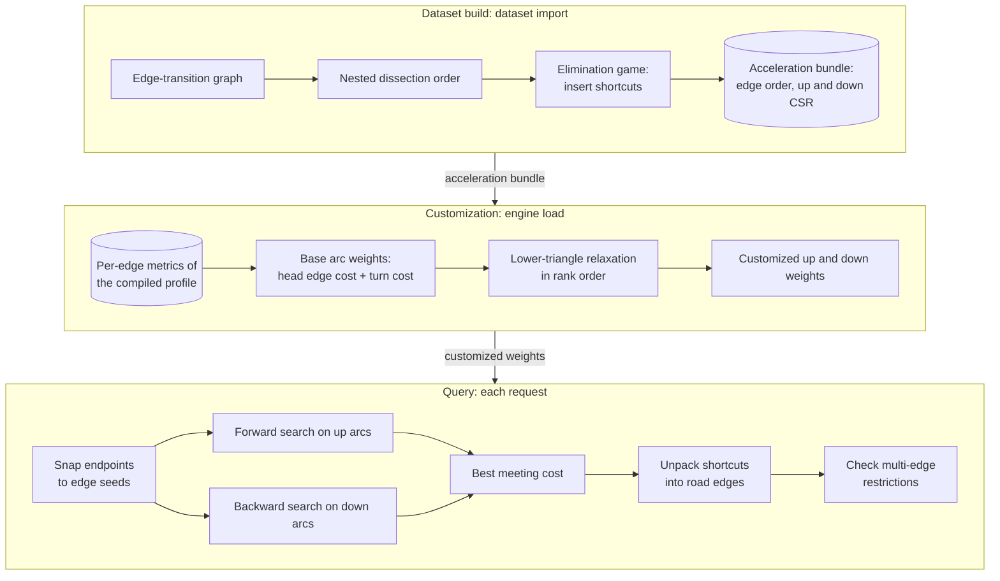

# Routing engine

NetWeevil uses an edge-based Customizable Contraction Hierarchy (CCH) to
calculate routes quickly. The work has three phases:

1.  **Dataset build.** The import calculates the hierarchy. The hierarchy
    depends only on the legal transitions of the street network.
2.  **Customization.** The engine calculates the arc weights for one
    profile. It does not build the hierarchy again.
3.  **Query.** A bidirectional search finds the best path. Then
    reconstruction expands the shortcuts into road edges.

## Terms

| Term | Meaning |
| ---- | ------- |
| State | A vertex of the hierarchy. Each state is one directed road edge. |
| Base arc | A legal transition from one directed edge to the next. Permitted U-turns are base arcs. |
| Shortcut | An arc that the contraction adds. It replaces a path through a lower-ranked state. |
| Rank | The position of a state in the elimination order. |
| Lower triangle | For an arc `x -> y`, a middle state `v` with a lower rank and the arcs `x -> v` and `v -> y`. |
| Weight unit | 1/1024 of the metric unit. |

## Dataset build

The import builds the hierarchy one time for each dataset.

1.  Nested dissection partitions the undirected edge-transition graph.
    Recursive partitions put separator states last. Minimum-degree
    elimination orders the small leaf parts.
2.  The directed elimination game contracts the states in rank order. To
    contract `v`, it inserts `x -> y` for each path `x -> v -> y` where both
    endpoints have a higher rank than `v`. It does not insert `x -> x`.
3.  The build removes duplicate arcs. It has no limit on the number of
    insertions.

The build keeps every necessary shortcut. Thus the hierarchy keeps all
shortest paths for every nonnegative profile metric that NetWeevil supports.

The acceleration bundle contains:

- The edge order. The rank is the inverse of the order. The loader
  calculates the rank again at load.
- The upward and the downward CSR adjacency, sorted by head id. Each row
  stores its heads as gaps.

The bundle does not contain expanded shortcut paths.

## Customization

Customization calculates the arc weights for one compiled profile.

1.  Each base arc gets the cost of its head edge plus the transition
    penalty.
2.  A forbidden transition starts at infinity. A shortcut without a
    reachable decomposition also starts at infinity.
3.  Basic customization processes the states in increasing rank. For each
    lower triangle, it sets
    `w(x -> y) = min(w(x -> y), w(x -> v) + w(v -> y))`.
4.  Both child weights are final before the customization visits their
    triangle.

### Parallel customization

Customization runs in parallel. The result is the same as a sequential
pass.

- An elimination tree (Liu's algorithm over the lower neighbours of each
  state) puts each state that can write an arc that a middle state reads
  inside the subtree of that middle state.
- Subtrees of at most `max(n/256, 1024)` states relax at the same time.
  Each subtree relaxes in rank order.
- The remaining top states then relax in rank order. A large middle state
  divides its incoming arcs across threads.
- Concurrent writes to shared separator arcs use an atomic `fetch_min`.
  The `min` operation does not depend on the order. Thus the weights are
  bit-identical to a sequential pass.

### Weights

Each arc has up to three `u32` weights: generalized cost, travel time and
distance.

- Compiled profile bundles store only the per-edge metrics. Customization
  is a pure function of these metrics, the topology and the dataset
  hierarchy. Thus the engine customizes the generalized-cost weights when it
  loads a profile.
- Only PHAST service areas read the travel-time and distance weights. The
  engine customizes them at the first service-area request. The routing
  graphs of the engine share them. An engine that only calculates routes
  does not keep them.
- Base transition costs round to the nearest weight unit.
- Infinity and finite overflow have different sentinel values. Overflow
  cannot make a reachable route unreachable.
- If a metric cannot be represented, the engine uses exact routing.

### Rounding error

For a path with `n` transitions, the rounding error is at most `n/2048`
metric units.

Quantization can change the selected route when two routes have almost the
same cost. If the selected path has `n` transitions and the exact optimal
path has `m` transitions, the excess original cost of the selected path is
at most `(n + m)/2048`. This bound holds with the endpoint costs held fixed.

!!! note
    Route summaries calculate the costs from the reconstructed road edges
    and the original profile metrics. They do not use the quantized
    weights.

Service-area labels have the same error bound. Thus threshold membership can
be different for edges whose cost is within that bound of the limit.

## Query

The engine keeps one copy of the customized hierarchy, renumbered by rank:

- Upward arcs, grouped by tail, each with its weight.
- Downward arcs, grouped by head, each with its weight.

This copy contains the only cost weights. The arcs keep their slots in the
dataset bundle. Reconstruction finds the slot from the endpoints. Upward
rows keep the row order of the bundle. Downward rows list the tails by edge
id. Thus each search relaxes the arcs in the same order as on the bundle
arrays.

1.  Snapping converts the origin and the destination to seeds. An endpoint
    inside an edge becomes a partial-edge seed.
2.  The forward search follows upward arcs from the origin seeds.
3.  The backward search follows reversed downward arcs from the destination
    seeds.
4.  Each direction stops when its queue minimum plus a lower bound on the
    opposite seed cost reaches the best complete cost.

!!! note
    A destination seed can have a negative cost. The seed subtracts the
    unused part of a snapped edge. The sum of the two queue minima is not a
    valid stop criterion, because the two searches use different arc sets.

### Reconstruction

1.  For each arc of the path, reconstruction finds a lower triangle whose
    integer child weights sum to the parent weight.
2.  It expands the two children.
3.  An arc without a matching lower triangle is a base transition.

The middle rank decreases at each step. Thus reconstruction always stops,
also for zero-cost transitions. The bundles do not contain middle-state
arrays or full shortcut expansions.

### Turn restrictions and the exact engine

- The exact engine is the reference for differential tests. It also handles
  metric overflow.
- A hierarchy query optimizes the quantized metric. The engine checks the
  candidate path against multi-edge turn restrictions.
- If the candidate violates a restriction, the engine uses an exact
  automaton search. A legal candidate needs no exact search.
- Matrix searches share complete CCH search spaces. They validate each
  reconstructed path. When a candidate is illegal, they resume the
  restriction-aware Dijkstra frontier of the current origin.

The `service.route_engine` field of an API response names the engine that
calculated the result, for example
`cch_with_restriction_sequence_validation`.

## Bundle validation

- Readers require the current bundle format and schema. An unsupported
  dataset bundle causes an error with a re-import instruction.
- The engine validates each compiled profile against the acceleration
  bundle id of the dataset. A stale compiled profile compiles again.
- Customization at load runs only when these items of the profile agree
  with the dataset hierarchy: the acceleration header, the topology bundle
  id, the algorithm and the schema. If they do not agree, engine
  preparation reports the difference.
