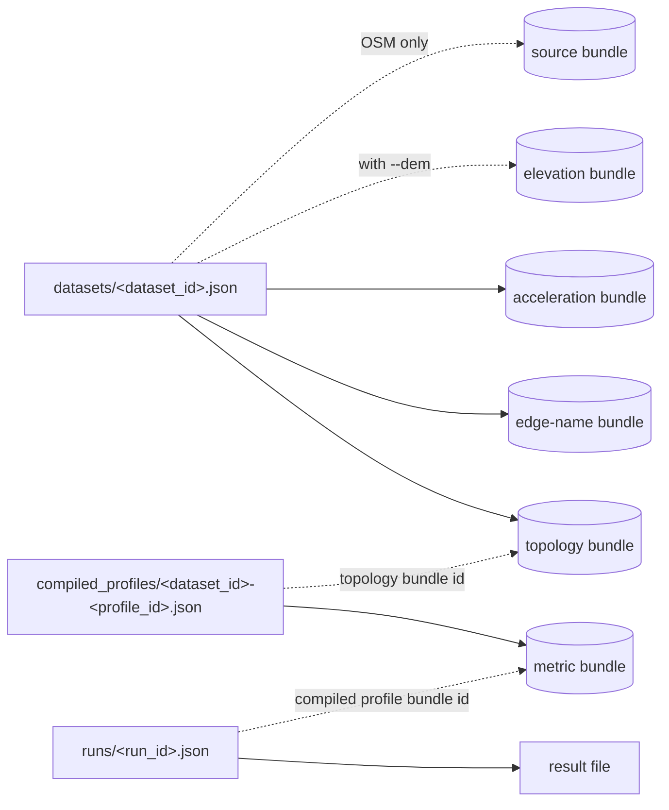

# State directory

NetWeevil writes all its state to one directory: `.netweevil/`. The state
directory is in the workspace. The workspace is the current directory of
the `netweevil` command. NetWeevil does not change source files.

The crate `netweevil-persist` defines the layout. The type
`WorkspacePaths` contains each path.

!!! tip
    `netweevil bootstrap` prints each directory of the state directory and
    its purpose. `GET /v1/workspace` sends the same list.

## Tree

```text
<workspace>/
└── .netweevil/
    ├── workspace.json                 # Selection that api serve loads without arguments
    ├── uploads/                       # Files uploaded through the web console
    ├── profiles/                      # Profiles written in the web console (YAML)
    ├── datasets/
    │   └── <dataset_id>.json          # Dataset manifest
    ├── compiled_profiles/
    │   └── <dataset_id>-<profile_id>.json   # Compiled profile manifest
    ├── transit_feeds/
    │   └── <feed_id>.json             # Transit feed manifest
    ├── gtfs_scenarios/
    │   ├── <scenario_id>.json         # GTFS editor scenario
    │   └── <scenario_id>.gtfs.zip     # Exported scenario
    ├── traffic/
    │   └── <traffic_id>.json          # Historical traffic manifest
    ├── terrain/                       # Prepared DEM tiles that the API serves
    ├── runs/
    │   ├── <run_id>.json              # Run manifest
    │   └── <run_id>-result.json       # Result when --out is not given
    ├── reports/                       # Rendered reports
    └── bundles/
        ├── topology/      topology-<dataset_id>-<build>.bin
        ├── names/         edge-names-<dataset_id>-<build>.bin
        ├── acceleration/  acceleration-<dataset_id>-<build>.bin
        ├── elevation/     elevation-<dataset_id>-<build>.bin
        ├── source/        source-<dataset_id>-<build>.bin
        ├── metrics/       metric-<dataset_id>-<profile_id>.bin
        ├── transit/       transit-<feed_id>.bin, transfers-<feed_id>-<dataset_id>-<profile_id>.bin
        └── traffic/       traffic-<traffic_id>.bin
```

`<build>` is a random 12-character id. Each import of a dataset gets a new
build id.

## Manifests and bundles

NetWeevil keeps two types of files:

- A **manifest** is a JSON file. It describes one item and refers to its
  bundles by path and bundle id.
- A **bundle** is a binary `.bin` file. It contains the large arrays of one
  item.



| Directory | Written by | Contents |
| --------- | ---------- | -------- |
| `datasets/` | `dataset import`, `dataset update` | One dataset manifest for each dataset. |
| `bundles/topology/` | `dataset import` | Nodes, directed edges, edge attributes and turn restrictions. |
| `bundles/names/` | `dataset import` | Street names, route numbers, lanes and signposts. The engine reads them only when a request needs them. |
| `bundles/acceleration/` | `dataset import` | The edge order and the CCH shortcut structure. See [Routing engine](routing-engine.md). |
| `bundles/elevation/` | `dataset import --dem` | The cropped DEM raster for height queries. |
| `bundles/source/` | `dataset import` (OSM PBF only) | The OSM source objects that `dataset update` applies change files to. |
| `compiled_profiles/` | `profile compile` | One manifest for each pair of dataset and profile. It contains the full profile document. |
| `bundles/metrics/` | `profile compile` | The per-edge metrics of a compiled profile. |
| `transit_feeds/`, `bundles/transit/` | `transit import`, `transit transfers build` | Transit feed manifests, timetables and transfer tables. |
| `traffic/`, `bundles/traffic/` | `traffic import` | Historical traffic speeds. |
| `runs/` | `analyze`, `experiment`, `simulate` | Run manifests and result files. |
| `reports/` | `report render` | Rendered reports. |
| `uploads/`, `profiles/`, `gtfs_scenarios/` | The web console | Uploaded files, profiles and GTFS editor scenarios. |
| `workspace.json` | `api serve` with arguments, the web console | The selected dataset, profiles, transit feeds and traffic set. |

## Compiled profiles

A compiled profile manifest has the id `<dataset_id>-<profile_id>`. It
contains:

- The dataset id and the profile id.
- The full profile document.
- The topology bundle id of the dataset at compile time.
- The path of the metric bundle.

The metric bundle contains only per-edge metrics. It does not contain CCH
weights. An engine calculates the CCH weights when it loads the profile.

`netweevil analyze` finds the compiled profile that has the same dataset id
and the same profile document as the command. If the profile document
changes, compile the profile again.

## Run manifests

The CLI writes a run manifest for each analysis to `runs/<run_id>.json`.
The `run_id` is a UUID. A run manifest contains:

- The run kind and the status.
- The dataset id, the profile id and the compiled profile bundle id.
- The path of the request file and the effective request.
- The path of the result file.
- The software version and the engine description.

The engine is deterministic. The dataset source extract, the profile
document and the effective request are sufficient to calculate the same
result again.

## Bundle format

All bundles use one sectioned binary format with the magic number
`NWSECB06`. Large arrays load with one memory copy from the mapped file.
Sections use lossless column encodings and deflate compression.

!!! warning
    NetWeevil reads only the current bundle format. A bundle in a different
    format causes an error with a re-import instruction. Import the dataset
    again and compile the profiles again.

## Clean the state directory

Each profile change makes a new metric bundle. Each import makes new dataset
bundles. To remove the files that no manifest uses:

1.  List the files that the command removes:

    ```bash
    netweevil cache prune --dry-run
    ```

2.  Remove the files:

    ```bash
    netweevil cache prune
    ```

`cache prune` removes stale compiled profiles and bundle files that no
manifest refers to. It does not remove transit bundles.

To remove all state, delete the `.netweevil/` directory. The next command
creates the directory again.

!!! note
    The repository `.gitignore` file excludes `/.netweevil/`. Do not commit
    the state directory.
