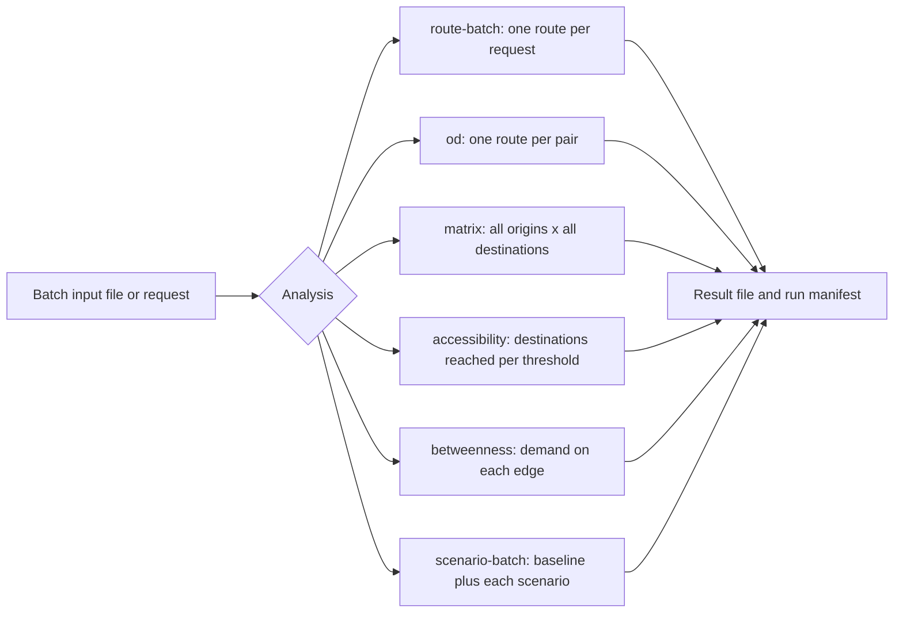
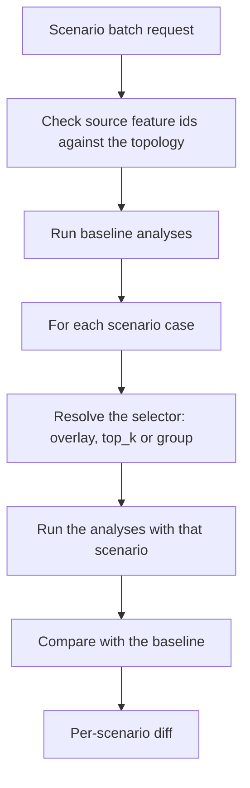

# Batch analysis

This guide shows how to run many street routes in one operation. It covers
route batches, origin-destination (OD) pairs, travel-time matrices,
accessibility counts, edge betweenness and scenario batches.



## Prerequisites

- An imported dataset and a compiled profile. See [Datasets](datasets.md).
- For HTTP requests: a running API that loads the profile.

## Input file formats

| Input | CSV columns | JSON or YAML shape |
| --- | --- | --- |
| OD pairs | `id,source_lon,source_lat,target_lon,target_lat`, optional `source_z,target_z` | `{pairs: [{pair_id, origin, destination}], ...}` |
| Point set | `id,lon,lat`, optional `z` | `{points: [{id, lon, lat, z?}], ...}` |

JSON and YAML documents can also carry the same `snap`, `connectivity`,
`fallback`, `returns`, `alternatives`, `avoid`, `vehicle` and temporal fields
as a route request. A CSV file uses the default values. See
[Routing](routing.md#route-request-fields).

## Output formats

The `--out` extension selects the format. Without `--out`, the CLI writes
JSON to `.netweevil/runs/`.

| Command | Formats |
| --- | --- |
| `analyze route`, `od`, `matrix`, `service-area` | `.json`, `.csv`, `.geojson`, `.gpkg`, `.parquet`, `.geoparquet` |
| `analyze route-batch` | `.json`, `.gpkg` |
| `analyze accessibility` | `.json`, `.csv` |
| `analyze betweenness` | `.json`, `.csv`, `.geojson`, `.gpkg` |
| `analyze scenario-batch` | `.json` |

Each CLI run also writes a run manifest. See
[Reports and experiments](reports-and-experiments.md).

## Run a route batch

A route batch writes many routes into one file. A GeoPackage output is ready
for QGIS.

1. Write a batch file. `requests` is a list of `{profile_id?, request}`.
   Each `request` is a `/v1/route` request.

    ```json
    {"requests": [{"profile_id": "car_research_v3", "request": {"route_id": "r1", "origin": {"id": "a", "lon": 6.5665, "lat": 53.2194}, "destination": {"id": "b", "lon": 6.5716, "lat": 53.2148}}}]}
    ```

2. Run the batch:

    ```bash
    cargo run --release -p netweevil-cli -- analyze route-batch \
      --dataset groningen_2026_05 \
      --profile examples/profiles/car_research_v3.yml \
      --requests .netweevil/requests/groningen_routes.json \
      --out .netweevil/runs/groningen_routes.gpkg
    ```

The GeoPackage contains these layers and tables:

| Layer | Contents |
| --- | --- |
| `routes` | Route line geometry |
| `route_segments` | Segment rows, without geometry |
| `route_breakdown_road_class` | Road-class breakdown |
| `route_breakdown_surface` | Surface breakdown |
| `route_violations` | Violations |
| `route_failures` | Failures |

## Route OD pairs

=== "CLI"

    ```bash
    cargo run -p netweevil-cli -- analyze od \
      --dataset groningen_2026_05 \
      --profile examples/profiles/car_research_v1.yml \
      --pairs examples/requests/od_pairs.csv \
      --out .netweevil/runs/example-od.gpkg
    ```

=== "HTTP"

    ```bash
    curl -X POST http://127.0.0.1:8080/v1/od \
      -H 'content-type: application/json' \
      --data @examples/api/ile_de_france_od.json
    ```

    The envelope is `{profile_id?, engine_mode?, request}`. The `request` is
    an OD pairs document.

## Calculate a matrix

A matrix calculates travel time and distance from each origin to each
destination.

=== "CLI"

    ```bash
    cargo run -p netweevil-cli -- analyze matrix \
      --dataset groningen_2026_05 \
      --profile examples/profiles/car_research_v1.yml \
      --origins examples/requests/matrix_origins.csv \
      --destinations examples/requests/matrix_destinations.csv \
      --out .netweevil/runs/example-matrix.gpkg
    ```

=== "HTTP"

    ```bash
    curl -X POST http://127.0.0.1:8080/v1/matrix \
      -H 'content-type: application/json' \
      --data @examples/api/ile_de_france_matrix.json
    ```

    The `request` is `{origins, destinations}`. Each side is a point set
    document.

Each point set has its own `snap` object. If an id occurs in both sets, its
point constraints must agree. For `avoid`, the engine merges both sets. Each
set that names a `vehicle` must name the same vehicle.

!!! warning
    A matrix can have at most 4,000,000 cells (origins × destinations).
    Split a larger matrix into chunks.

A successful matrix can contain unreachable cells. The result reports
succeeded, failed and ignored cell counts.

## Count accessible destinations

Accessibility counts the destinations of each category that each origin
reaches within each time threshold.

=== "CLI"

    1. Write one point set per destination category.
    2. Run the analysis. Repeat `--destination` for each category:

        ```bash
        cargo run -p netweevil-cli -- analyze accessibility \
          --dataset groningen_2026_05 \
          --profile examples/profiles/pedestrian_research_v1.yml \
          --origins examples/requests/matrix_origins.csv \
          --destination shops=examples/requests/matrix_destinations.csv \
          --thresholds-s 300,600,900 \
          --max-travel-time-s 1200 \
          --out .netweevil/runs/accessibility.csv
        ```

=== "HTTP"

    Send `POST /v1/accessibility` with this `request`:

    | Field | Default | Meaning |
    | --- | --- | --- |
    | `origins` | required | Point set document |
    | `categories[]` | `[]` | `{category_id, destinations}`. `destinations` is a point set document |
    | `thresholds_s` | `[]` | Time thresholds in seconds |
    | `max_travel_time_s` | required | Longest search time from each origin |

The CLI defaults are `--thresholds-s 300,600,900,1200` and
`--max-travel-time-s 1200`.

## Calculate edge betweenness

Demand-weighted edge betweenness multiplies each origin weight by each
destination weight. It adds that demand to each directed edge on the route
between them. The analysis can run with static costs or with temporal
fields.

=== "CLI"

    ```bash
    cargo run -p netweevil-cli -- analyze betweenness \
      --dataset hk_pedestrian_3d \
      --profile examples/profiles/pedestrian_multilayer.yml \
      --request examples/requests/hong_kong_example_betweenness.json \
      --out .netweevil/runs/hk-example-betweenness.gpkg
    ```

=== "HTTP"

    Send the same request to `POST /v1/betweenness`. Add `?format=geojson`
    for GeoJSON.

| Field | Default | Meaning |
| --- | --- | --- |
| `analysis_id` | required | Identifier of the result |
| `origins[]`, `destinations[]` | required | `{id, lon, lat, z?, weight}` |
| `snap` | defaults | Snapping options |
| `max_od_pairs` | 2,000,000 | Upper limit of origin-destination pairs |
| `include_zero` | `false` | Includes edges with a zero score |
| temporal fields | none | `departure_time`, `scenario`, `holidays`, `overlays` and others |

The result stores one score per directed edge. Each score has the source
feature id, the routed-pair count, the raw score, the normalized score and
the 3D geometry.

## Run a scenario batch

A scenario batch runs a set of analyses once as a baseline. Then it runs them
again for each scenario case. Each case replaces only the scenario overlay.
The embedded requests keep their holiday calendars and continuous overlays.



=== "CLI"

    ```bash
    cargo run -p netweevil-cli -- analyze scenario-batch \
      --dataset hk_pedestrian_3d \
      --profile examples/profiles/pedestrian_multilayer.yml \
      --request examples/requests/hong_kong_example_scenario_batch.yml \
      --out .netweevil/runs/hk-example-scenario-batch.json
    ```

=== "HTTP"

    Send the same document, with files inlined, to `POST /v1/scenario-batch`.

### Scenario batch fields

| Field | Meaning |
| --- | --- |
| `batch_id` | Identifier of the batch |
| `departure_time` | Used when an analysis request has no time of its own |
| `scenarios[]` | Scenario cases. Each case has an `id` and exactly one selector |
| `routes[]` | Route requests |
| `service_areas[]` | Service-area requests |
| `accessibility[]` | Accessibility requests |
| `od[]` | `{analysis_id, request}`. `request` is an OD pairs document |
| `matrices[]` | `{analysis_id, origins, destinations}` |
| `betweenness[]` | Betweenness requests |

Each scenario case selects exactly one source:

- `overlay`: an inline scenario overlay.
- `top_k`: `{ranking: [{source_feature_id, score}], count}`. The engine closes
  the `count` features with the highest scores. Scores of repeated features
  add up.
- `group`: `{attribute, value}`. The engine closes all features with that
  retained attribute value. `attribute` is a source column name or a semantic
  role.

In a batch document that the CLI reads, `overlay_file` and
`top_k.ranking_file` name local files to inline. `ranking_file` accepts CSV,
JSON, YAML or a prior betweenness-result JSON.

```yaml
scenarios:
  - id: explicit_failure
    overlay_file: failures/lift.yml
  - id: top_10_critical
    top_k:
      ranking_file: outputs/betweenness.json
      count: 10
  - id: close_one_mall
    group:
      attribute: building_id_1
      value: "1234"
```

The engine checks each source feature id in an overlay or ranking against the
active topology before the baseline runs. A selector for an older topology
thus fails with an error. It does not create an ineffective closure.

### Scenario batch result

Generated `top_k` and `group` cases return their resolved
`closed_source_feature_ids`. You can audit the exact closure set.

The diff for each scenario reports:

- disconnected route and accessibility demand;
- disconnected OD pairs, matrix cells and betweenness pairs;
- signed and positive rerouting burden;
- weighted disconnected demand;
- edge-usage score change;
- service-area network loss;
- reachable-destination loss.

The engine matches betweenness losses by baseline origin and destination
indexes. Thus new reachable demand cannot hide a different pair that became
disconnected. Scenario snapshots include these compact pair outcomes.
Ordinary betweenness edge exports omit them.

File references anywhere in a request document that the CLI reads resolve
relative to that document. This includes the temporal files of OD, matrix and
betweenness inputs inside a scenario batch.

## Temporal overrides on the CLI

The `route`, `directions`, `route-batch`, `od`, `matrix`, `accessibility`,
`service-area`, `service-area-sequence` and `betweenness` commands accept
these flags:

| Flag | Effect |
| --- | --- |
| `--departure-time` | Replaces the request departure time (RFC 3339) |
| `--scenario` | Replaces the request scenario with a local scenario file |
| `--holiday-calendar` | Replaces the request holidays with a local calendar file |
| `--overlay` | Appends a local temporal overlay file (CSV or Parquet). Repeatable |

See [Multilayer and temporal routing](multilayer-temporal-routing.md#temporal-requests-scenarios-and-overlays)
for the merge rules.

## Related pages

- [Routing](routing.md) for the route request fields.
- [Service areas](service-areas.md).
- [Traffic](traffic.md) for batches with a departure time.
- [HTTP API reference](../api/reference.md) for the full schema.
