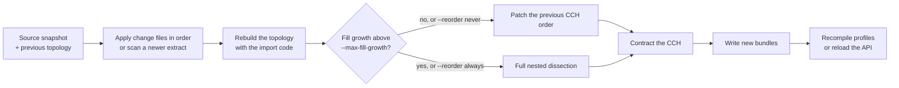

# Datasets

A dataset is an imported road or path network in the workspace. This guide
shows how to import OSM, Overture Maps and GeoPackage sources. It also shows
how to prepare routing-only OSM extracts and how to update an OSM dataset
with change files.

## Prerequisites

- A source file:
    - an OSM `.osm.pbf` extract;
    - an Overture Maps transportation GeoParquet file or a directory of them;
    - one or more GeoPackages with a mapping file.
- Optional: `osmium` to filter OSM extracts.
- Optional: boundaries and a DEM. See
  [Regions and elevation](regions-and-elevation.md).

`datasets/README.md` has download commands for the example sources.

## Import a dataset

=== "CLI"

    1. Import the source:

        ```bash
        cargo run -p netweevil-cli -- dataset import \
          datasets/groningen-260508-routing.osm.pbf \
          --name groningen_2026_05
        ```

    2. Compile a profile for the dataset:

        ```bash
        cargo run -p netweevil-cli -- profile validate \
          examples/profiles/car_research_v1.yml

        cargo run -p netweevil-cli -- profile compile \
          --dataset groningen_2026_05 \
          --profile examples/profiles/car_research_v1.yml
        ```

    3. List the datasets with `netweevil dataset list`.

=== "HTTP"

    See [Import through the API](#import-through-the-api).

| Flag | Default | Meaning |
| --- | --- | --- |
| `<SOURCES>...` | required | OSM extract, Overture GeoParquet file or directory, or GeoPackages |
| `--name` | required | Id of the new dataset |
| `--format` | from the path | `osm-pbf`, `overture` or `gpkg` |
| `--mapping` | none | GeoPackage field and semantic mapping (YAML or JSON) |
| `--admin-boundaries` | none | Boundaries file. See [Regions and elevation](regions-and-elevation.md#administrative-areas) |
| `--dem` | none | DEM to sample. See [Regions and elevation](regions-and-elevation.md#elevation) |
| `--dem-crs` | none | DEM CRS |
| `--dem-vertical-datum` | none | Vertical datum label |

Each import assigns IANA time zones. Boundaries add driving sides, border
crossings and regional profile rules. A DEM adds grades, elevation profiles
and `/v1/height`.

### What an OSM import reads

The importer uses:

- routable `way` objects with `highway=*`;
- ferry `way` objects with `route=ferry` or `ferry=*`;
- turn-restriction `relation` objects with `type=restriction`;
- traffic-signal `node` objects with `highway=traffic_signals`;
- the referenced nodes and relation members that keep the topology valid.

OSM imports also keep vehicle restrictions (see
[Routing](routing.md#vehicle-dimensions-weight-and-hazardous-goods)) and
`:conditional` tags (see
[Multilayer and temporal routing](multilayer-temporal-routing.md#osm-conditional-tags)).

### Bundle format

Imports write `.bin` bundles in the compact sectioned format (`NWSECB06`:
lossless column encodings plus deflate). The reader rejects a bundle in
another format with a message to re-import.

Each profile change compiles a new metric bundle. To remove old files:

1. List what `cache prune` removes:

    ```bash
    cargo run -p netweevil-cli -- cache prune --dry-run
    ```

2. Remove the files:

    ```bash
    cargo run -p netweevil-cli -- cache prune
    ```

A compiled profile is stale in these conditions:

- its dataset was removed or re-imported;
- its bundle is missing or in an old format;
- a newer compile of the same profile id exists.

Stale profiles recompile on demand. `cache prune` also removes
bundle files that no manifest references. It does not touch transit bundles.
`cache list` lists the datasets, compiled profiles and transit feeds.

## Prepare a routing-only OSM extract

A full extract contains many objects that routing does not use. A filtered
extract imports faster and makes a much smaller source snapshot for updates.

1. Write the filter expressions:

    ```bash
    cat > netweevil-routing-filters.txt <<'EOF'
    w/highway
    w/route=ferry
    w/ferry
    r/type=restriction
    n/highway=traffic_signals
    EOF
    ```

2. Filter the extract with `osmium`:

    ```bash
    osmium tags-filter \
      --expressions=netweevil-routing-filters.txt \
      --remove-tags \
      source.osm.pbf \
      -o routing-only.osm.pbf \
      -O
    ```

!!! warning
    Do not pass `-R` or `--omit-referenced`. NetWeevil needs the referenced
    topology objects.

## Import Overture Maps data

`dataset import` accepts Overture Maps transportation-theme GeoParquet: a
single `.parquet` or `.geoparquet` file, or a directory of them. The importer
reads only segment files. It skips connector files in the same directory. The
format comes from the path. Use `--format overture` or `--format osm-pbf` to
force it.

```bash
cargo run -p netweevil-cli -- dataset import \
  datasets/overture-groningen-segments.parquet \
  --name groningen_overture
```

The importer reads road-subtype segments and maps these fields:

| Overture field | Use |
| --- | --- |
| `class`, `subclass` | Highway classification, including `link` ramps |
| `connectors` | Graph nodes. Segments split into connector-to-connector chunks, so linearly scoped rules apply per chunk |
| `access_restrictions` | Access per mode and direction. Heading-scoped denials become one-ways. Time- or vehicle-conditional rules are skipped |
| `speed_limits` | Posted limits per direction. mph is converted to km/h |
| `road_surface`, `road_flags` | Surface. Segments under construction and abandoned segments are dropped |
| `prohibited_transitions` | Turn restrictions |
| `lanes` | Lane counts per direction, on releases that still carry the column |
| `is_bridge`, `is_tunnel` | Structures that are not draped on a DEM |

### Posted speed limits

Posted speed limits combine with profile speeds by the profile's
`speeds.posted_limits` setting:

| Value | Behavior |
| --- | --- |
| `prefer` | The posted limit replaces the profile speed where the data has one |
| `cap` (default) | Travel is never faster than the posted limit. Lower profile speeds win |
| `ignore` | Profile speeds only |

Lane counts feed the traffic simulation. Both work for OSM sources through
the `maxspeed` and `lanes` tags.

## Import GeoPackages

GeoPackage imports need `--format gpkg` and a `--mapping` file. Inputs must
already be in WGS84 longitude and latitude with Z in metres. See
[Multilayer and temporal routing](multilayer-temporal-routing.md#map-and-import-geopackages)
for the mapping roles, the preparation contract and `dataset audit`.

!!! note
    GeoPackage imports keep their surveyed heights. They reject `--dem`.

## Import through the API

The web console uses the workspace endpoints. All writes stay under
`.netweevil/`.

1. Upload each file with `POST /v1/workspace/uploads?name=<file>`. The raw
   body streams to `.netweevil/uploads/`.
2. Start the import with `POST /v1/workspace/datasets/import`.
3. Follow the job with `GET /v1/workspace/jobs/{id}`.

| Field | Meaning |
| --- | --- |
| `sources` | Upload names. Several Overture parquet files can be combined |
| `name` | Id of the new dataset |
| `format` | `osm_pbf`, `overture_parquet` or `geo_package`. Detected when absent |
| `mapping` | Upload name of a GeoPackage mapping |
| `admin_boundaries` | Upload name of a boundaries file |
| `dem` | `{source, crs?, vertical_datum?}`. `source` is an upload name |

!!! note
    All file fields are upload names in `.netweevil/uploads/`, never server
    paths. Import other files with the CLI.

`DELETE /v1/workspace/datasets/{id}` removes a dataset.
`DELETE /v1/workspace/uploads/{name}` removes an upload.

## Update an OSM dataset

An OSM PBF import keeps the source objects that updates need. Apply OSM
change files (Geofabrik daily diffs, OSM replication diffs) instead of a full
re-import.



=== "CLI"

    1. Apply the change files:

        ```bash
        cargo run -p netweevil-cli -- dataset update \
          --dataset groningen_2026_05 \
          --diff groningen-updates/000/002/735.osc.gz groningen-updates/000/002/736.osc.gz
        ```

        Alternatively, rebuild from a newer extract of the same area:

        ```bash
        cargo run -p netweevil-cli -- dataset update \
          --dataset groningen_2026_05 --source groningen-latest-routing.osm.pbf
        ```

    2. Recompile the profiles, or send `POST /v1/workspace/reload` to a
       running API.

=== "HTTP"

    1. Upload the change files or the new extract.
    2. Send `POST /v1/workspace/datasets/{id}/update` with
       `{diffs: [...]}` or `{source: "<pbf>"}`. Optional fields are
       `reorder` (`auto`, `always`, `never`) and `max_fill_growth`.

    The job runs `dataset update`. When the dataset is loaded, the API loads
    the updated build next to the running one. It swaps it in when it is
    ready. The previous runtime serves requests until the swap.

| Flag | Default | Meaning |
| --- | --- | --- |
| `--dataset` | required | Id of an imported OSM dataset |
| `--diff` | none | osmChange file (`.osc` or `.osc.gz`). Repeat to apply several in order |
| `--source` | none | A newer `.osm.pbf` extract of the same area, instead of change files |
| `--reorder` | `auto` | `auto`, `always` or `never` |
| `--max-fill-growth` | 1.1 | Fill growth above which `--reorder auto` reorders |

`POST /v1/workspace/reload` reloads the loaded selection from disk, for
example after a CLI `dataset update`. It recompiles the profiles that were
compiled for the previous topology. The previous runtime serves requests
until the swap. The reload carries the live traffic state over.

### Source snapshot

An OSM import reads the extract in one pass. It writes a source snapshot to
`.netweevil/bundles/source` next to the other bundles. The snapshot holds:

- each node position. Topology nodes store only their OSM id, because the
  topology bundle already holds their coordinates;
- the routable ways as classified records. Id, node list and name are
  separate columns. The other data is interned. This includes guidance tags,
  vehicle restrictions, destination-only and conditional access, and the ids
  of their temporal rule sets;
- the turn-restriction relations, one record per kind, mode set and
  condition, and the temporal rule sets that they and the ways use;
- the traffic-signal and motorway-junction nodes, and the routable ways on
  bridges or in tunnels;
- the other ways with their node lists, and the ids of the other relations.
  These keep the source object counts exact. They also let the update
  assemble admin boundaries from the kept `boundary=administrative`
  relations;
- the paths of the boundaries file and the DEM of the import.

A change file lists only the objects that it touches. A modified way can
reference an unmodified node that no routable way used before. Thus the
snapshot keeps all node positions.

!!! note
    The snapshot does not store raw tags. Changed objects arrive with all
    their tags. A classifier change requires a full re-import.

As a guide, the snapshot of a filtered province extract is about a third of
the PBF size. The snapshot of an unfiltered extract is much larger, because
it holds the positions of all building nodes.

### Apply changes

The update does these steps:

1. It restores the source state from the snapshot and the previous topology.
2. It applies each change file in order. Deletions remove the object.
   Creations and modifications replace it with the newest version in the
   file, as `osmium apply-changes` does. With `--source`, it scans the new
   extract instead.
3. It rebuilds the topology with the import code.

The topology is identical to a full import of `osmium apply-changes
base.osm.pbf changes...`. Rule-set ids depend on the order in which a scan
interns them. After each scan or change set, the state renumbers them as a
full import does: ways by id, forward before reverse, then restriction
relations by id. Thus the updated topology carries the same ids.

Updates read the boundaries file and the DEM again from the recorded paths.
They refuse to run when either file is missing. They resample the DEM, write
a new elevation raster, and assign time zones and admin areas again.

!!! warning
    An update applies whatever the recorded paths hold. Replace the
    boundaries file or the DEM only together with a full re-import.

### Reuse of the CCH order

The elimination order depends only on the topology. An edge state keeps its
previous rank when its identity survives: source way, OSM tail and head node,
and occurrence. Otherwise it takes an unclaimed state over the same node pair
(way splits and merges).

- A new state goes directly after its highest-ranked neighbor that already
  has a place. A state next to both sides of a separator goes into that
  separator. A state inside a cell stays there.
- States that only other new states reach go in breadth-first layers.
- Components with no reused state get a nested-dissection order and go first.

Contraction inserts each required shortcut for any order. Thus the hierarchy
stays complete and queries stay exact. Only the shortcut count depends on the
order.

Each update records the fill growth. The shortcut density of the last full
ordering predicts a shortcut count for the current edge count. The fill
growth is the actual shortcut count divided by that prediction.

- `--reorder auto` (default) reorders by nested dissection when the fill
  growth exceeds `--max-fill-growth`.
- `--reorder always` reorders each time. Use it for a scheduled full
  ordering.
- `--reorder never` always patches.

As a guide, one to two weeks of daily diffs on a province extract add less
than 1% of shortcuts relative to a fresh ordering. The recorded fill growth
follows the real excess for edits that add roads. Deletions also lower the
fresh count, so a change set with many closures underestimates it.

### Equivalence tests

`crates/ingest/src/update/tests.rs` imports a base extract and an
independently edited extract (written as PBF). It applies the change file to
the base and checks that:

- the topology bundle, edge names, topology metadata and source snapshot are
  equal to those of the full import;
- each sampled route has the same distance, time and generalized cost on the
  updated CCH engine, the exact engine of the full import and its CCH engine;
- a replacement extract with `--reorder always` gives the elimination order
  and shortcut count of the full import;
- chained change files build the same topology as one call with all files.

The synthetic edits cover:

- tag and speed changes;
- a closed road;
- a new road over new nodes;
- a moved node, a way split and a deleted node;
- a new signal;
- a new and a removed turn restriction;
- a building that becomes a road over nodes that were not in the topology.

The ingest grid completeness test also runs on a patched order.

`extract_update_matches_a_full_import` is an ignored test. It repeats the
comparison on a real extract with generated edits. It reads the extract from
`NETWEEVIL_UPDATE_TEST_PBF`. The default is
`datasets/groningen-260508-routing.osm.pbf`. Run it with a release build:

```bash
cargo test --release -p netweevil-ingest extract_update -- --ignored --nocapture
```

### Update time

An update skips the nested-dissection ordering that takes most of the import
time. As a guide, an update with one daily diff on a province extract takes a
few seconds, against tens of seconds for a full import. The update holds the
previous and the new build in memory at the same time. Thus its peak memory
is higher than that of an import.

## Related pages

- [Regions and elevation](regions-and-elevation.md).
- [Multilayer and temporal routing](multilayer-temporal-routing.md).
- [Traffic](traffic.md): traffic bundles bind to updated datasets by source
  feature id.
- [HTTP API reference](../api/reference.md) for the full schema.
