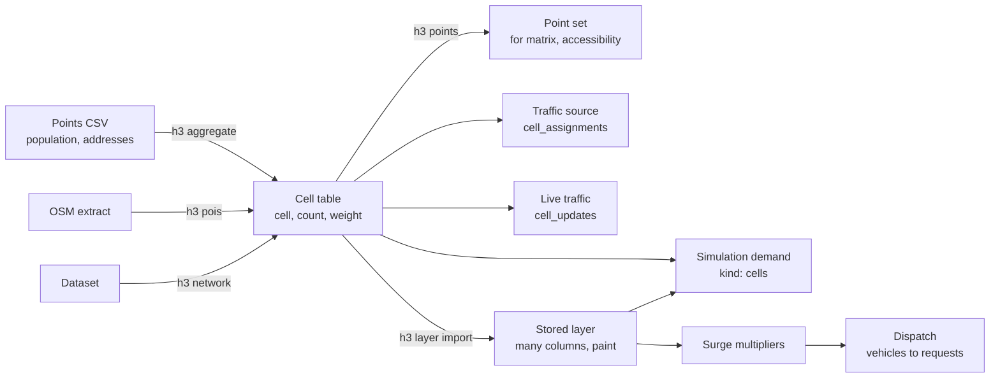

# H3 cells

This guide shows how to use [H3](https://h3geo.org/) hexagonal cells as a
spatial layer: for population and POI distributions, for traffic by area and
for simulation demand and zones.

A cell is a 15-digit hexadecimal id such as `88196d85ebfffff`. The
resolution is a number from 0 (continents) to 15 (about 1 m²). Each cell has
seven children at the next resolution.

| Resolution | Average area | Typical use |
| --- | --- | --- |
| 6 | 36 km² | Region |
| 7 | 5.2 km² | Town or district |
| 8 | 0.74 km² | Neighbourhood |
| 9 | 0.11 km² | Block |
| 10 | 0.015 km² | Street segment |



All cell work runs when you prepare or import data. Routing requests do not
use cells, thus cells do not change the speed of a request.

## Layers with more than one resolution

A layer can contain cells of different resolutions. When cells overlap, the
finest cell applies. Thus you can give a base value to a region with a few
coarse cells and then refine an area with fine cells:

```yaml
cell_assignments:
  - {cell: 86196d85fffffff, pattern: region}   # resolution 6: the region
  - {cell: 88196d85ebfffff, pattern: centre}   # resolution 8: one neighbourhood
```

Traffic cell assignments and the cell lookups of simulation zones follow
this rule. Live cell updates apply in the order of the request.

## Aggregate points into cells

`netweevil h3 aggregate` counts the points of a CSV in each cell, on one or
more resolutions. The CSV needs a longitude column and a latitude column.

```bash
netweevil h3 aggregate population.csv --resolutions 7,9 \
  --weight-column population --out population_cells.csv
```

| Flag | Default | Meaning |
| --- | --- | --- |
| `--resolutions` | required | Resolutions, separated by commas |
| `--lon-column`, `--lat-column` | `lon`, `lat` | Coordinate columns |
| `--weight-column` | none | Column to sum into `weight`. Without it, each point has the weight 1 |
| `--out` | required | Output file |

The output has one row for each cell of each resolution:

```csv
cell,resolution,count,weight
87196d85effffff,7,412,10250.0
89196d85ea7ffff,9,37,880.0
```

The extension of `--out` selects the format. This applies to all `h3`
commands that write cells:

| Extension | Format |
| --- | --- |
| `.csv` | Table with `cell`, `resolution` and the value columns |
| `.geojson` | `FeatureCollection` with one hexagon for each cell, for QGIS or a web map |
| `.json` | List of `{cell, resolution, ...}` objects |

`POST /v1/h3/aggregate` does the same for points in a request body. Add
`?format=geojson` to get hexagons.

## Count POIs and amenities

`netweevil h3 pois` reads an OSM extract. It counts the nodes and ways that
have a tag key, in each cell. A way counts at the mean position of its nodes.

```bash
netweevil h3 pois groningen-latest.osm.pbf --key amenity \
  --values school,kindergarten --resolutions 8 \
  --out schools.geojson --points-out schools.csv
```

| Flag | Default | Meaning |
| --- | --- | --- |
| `--key` | `amenity` | Tag key, for example `amenity`, `shop`, `leisure` or `office` |
| `--values` | all | Tag values to keep, separated by commas |
| `--resolutions` | required | Resolutions, separated by commas |
| `--out` | required | Output file with the counts |
| `--points-out` | none | Point-set CSV (`id,lon,lat,value,name`) of the POIs |

The file from `--points-out` is a point set. You can use it as the
destinations of `analyze matrix` or of an accessibility category.

!!! note
    Use the original OSM extract. An extract that contains only roads has no
    POIs.

## Summarize the network

`netweevil h3 network` counts the nodes and the directed edges of a dataset
in each cell. An edge counts in the cell of its midpoint.

```bash
netweevil h3 network --dataset groningen --resolution 8 --out network.geojson
```

The values are `node_count`, `edge_count` and `edge_length_m`. They show
where the network is dense, and which cells have no roads.
`GET /v1/h3/network?resolution=8` gives the same values for the loaded
dataset.

## Cover an area

`netweevil h3 cover` lists the cells whose centre is in a bounding box or in
a polygon.

```bash
netweevil h3 cover --bbox 6.50,53.18,6.62,53.25 --resolution 8 --out cells.csv
netweevil h3 cover --polygon district.geojson --resolution 9 --compact --out cells.json
```

`--polygon` reads the outer ring of the first polygon in a GeoJSON file.
`--compact` replaces each complete group of seven sibling cells by their
parent. The result then has mixed resolutions and fewer cells.

## Use cells in analyses

`netweevil h3 points` writes the centre of each cell as a point set. The
point id is the cell id.

```bash
netweevil h3 points population_cells.csv --out origins.csv
netweevil analyze accessibility --dataset groningen \
  --profile examples/profiles/cycling_north_nl_2026_05.yml \
  --request accessibility.json
```

Use the point set as the origins of a matrix, an OD batch, a service area or
an accessibility request. The ids in the result are cell ids. Thus you can
join the result to the cell table, for example to weight a travel time by
the population of the origin cell.

A cell table with mixed resolutions holds each point more than once. Filter
the table to one resolution before you use it as a point set.

## Change the resolution

`netweevil h3 resample` moves a weighted cell table to one resolution.

```bash
netweevil h3 resample population_cells.csv --resolution 7 --out population_r7.csv
```

A finer cell adds its weight to its parent. A coarser cell divides its
weight equally between its children. The total weight does not change.

## Cell layers

A cell layer is a stored table with named columns and one value for each
cell and column, for example `population`, `jobs`, `riders` and `drivers`.
The layers are in `.netweevil/cell_layers/`. You fill a layer with imports,
and you change it by painting.

### Import tables

`netweevil h3 layer import` reads a CSV into a layer. Each import can add
columns to a layer that exists. Thus one layer can hold data from many
sources.

```bash
# A cell table: one row for each cell.
netweevil h3 layer import population_cells.csv --name city

# A point table: aggregate the rows into resolution 8 cells.
netweevil h3 layer import households.csv --name city --resolution 8 \
  --value population --value income:mean=mean_income --value :count=households
```

`--value` selects a column and how the rows of one cell become one value:

| Form | Meaning |
| --- | --- |
| `column` | Sum of the column |
| `column:aggregation` | `sum`, `mean`, `min`, `max`, `count` or `last` |
| `column:aggregation=name` | Store the result in the layer column `name` |
| `:count=name` | Number of rows in the cell |

Without `--value`, the command sums each numeric column. Without
`--resolution`, the table needs a `cell` column. An import replaces the
values of the cells and columns that it contains. Other cells and columns
stay. `--replace` starts from an empty layer.

| Command | Result |
| --- | --- |
| `h3 layer list` | The stored layers and their columns |
| `h3 layer show city` | Cell count, resolutions and the statistics of each column |
| `h3 layer export city --out city.geojson` | The layer as `.csv`, `.geojson` or `.json` |
| `h3 layer remove city` | Deletes the layer |

### Paint values

`netweevil h3 layer paint` changes one column on a list of cells, or on the
cells of an area. The operation is `set` (default), `add`, `multiply` or
`clear`.

```bash
# Five drivers in each resolution 8 cell of the centre.
netweevil h3 layer paint city --column drivers --value 5 \
  --bbox 6.53,53.20,6.60,53.24 --resolution 8

# Ten more in one cell, then 20 % less in a district.
netweevil h3 layer paint city --column drivers --op add --value 10 --cells 88196d85ebfffff
netweevil h3 layer paint city --column drivers --op multiply --value 0.8 \
  --polygon district.geojson --resolution 8
```

The command makes the layer and the column when they do not exist. A cell
without a value in each column is removed.

In the web console, the **Cells** tool shows a layer on the map and paints
cells with the pointer. See [Web console](../tools/web-console.md).

### Layers in the API

| Operation | Purpose |
| --- | --- |
| `GET /v1/h3/layers` | List the layers |
| `POST /v1/h3/layers` | Create a layer from cells or CSV text. `merge: true` extends a stored layer, `replace: true` replaces it |
| `GET /v1/h3/layers/{layer_id}` | Get a layer as JSON, GeoJSON (`format=geojson`) or CSV (`format=csv`) |
| `POST /v1/h3/layers/{layer_id}/paint` | Paint cells, the cells of a list of positions, or an area |
| `DELETE /v1/h3/layers/{layer_id}` | Delete a layer |

`examples/api/h3_layer_points.json` and `examples/api/h3_layer_paint.json`
are request bodies.

## Surge: balance demand and supply

`netweevil h3 surge` compares demand and supply in each cell, in the style
of ride-hailing surge pricing. Demand is, for example, open ride requests.
Supply is free vehicles.

```bash
netweevil h3 surge --demand city:riders --supply city:drivers \
  --resolution 8 --rebalance-rings 3 --out surge.geojson
```

`--demand` and `--supply` take `layer:column`, or a cell table file. The
calculation has three steps:

1. It adds the cells up to the surge resolution.
2. It spreads the demand and the supply of each cell over the adjacent
   cells. Thus the multipliers change gradually between cells.
3. It divides the smoothed demand by the smoothed supply. A ratio above
   `balance_ratio` gives a multiplier above 1.

| Setting | Default | Meaning |
| --- | --- | --- |
| `resolution` | coarsest input | Resolution of the surge cells |
| `smoothing_rings` | 1 | Rings of adjacent cells that values spread over. 0 uses each cell alone |
| `ring_decay` | 0.5 | Weight of a ring relative to the ring inside it |
| `balance_ratio` | 1.0 | Demand for each unit of supply at which the multiplier starts to increase |
| `sensitivity` | 0.5 | Increase of the multiplier for each unit of relative surplus demand |
| `min_multiplier`, `max_multiplier` | 1.0, 3.0 | Limits of the multiplier |
| `step` | 0.1 | The multipliers round to this step |
| `min_supply` | 1.0 | Lower limit of the supply in the ratio |

The multiplier is `1 + sensitivity * (ratio / balance_ratio - 1)`, between
the limits. `--config` reads the settings from a JSON file.

`--rebalance-rings` also prints a plan that moves surplus supply to cells
with too little supply. The plan serves the largest shortage first, from the
nearest cells with a surplus. `POST /v1/h3/surge` gives the same results.

!!! note
    This is a transparent model of the balance, not the pricing algorithm of
    a ride-hailing company.

## Dispatch: assign vehicles to requests

`netweevil h3 dispatch` assigns ride requests to vehicles by the travel time
on the network from each vehicle to each pickup.

```bash
netweevil h3 dispatch --dataset groningen \
  --profile examples/profiles/car_research_v1.yml \
  --request examples/requests/dispatch_groningen.json
```

The request lists `vehicles` and `requests`:

```json
{
  "vehicles": [{"id": "car_1", "lon": 6.5665, "lat": 53.2194},
               {"id": "van_1", "lon": 6.5903, "lat": 53.2101, "vehicle_type": "van"}],
  "requests": [{"id": "ride_1", "pickup": {"lon": 6.5601, "lat": 53.2212},
                "dropoff": {"lon": 6.5362, "lat": 53.2405}},
               {"id": "group_1", "pickup": {"lon": 6.5702, "lat": 53.2171}, "vehicle_type": "van"}],
  "matching": {"max_pickup_time_s": 900},
  "surge": {"config": {"resolution": 8}},
  "pricing": {"base_fare": 2.5, "per_km": 1.4, "per_minute": 0.3, "minimum_fare": 6}
}
```

| Field | Meaning |
| --- | --- |
| `vehicles[]` | `{id, lon, lat, vehicle_type?}` |
| `requests[]` | `{id, pickup, dropoff?, vehicle_type?}`. With `vehicle_type`, only vehicles of that type serve the request |
| `matching.strategy` | `optimal` serves the most requests and then minimizes the total pickup time. `greedy` takes the shortest pickup first. `auto` (default) uses `optimal` for up to 600 requests or vehicles |
| `matching.max_pickup_time_s` | A vehicle with a longer pickup time does not serve the request |
| `matching.candidate_rings` | Only vehicles within this number of H3 rings of the pickup are candidates. Use it for large fleets |
| `surge` | Calculates surge multipliers. Without `demand` and `supply`, the pickups are the demand and the vehicles are the supply |
| `pricing` | `base_fare`, `per_km`, `per_minute`, `minimum_fare` and `vehicle_type_factors` |

One matrix request gives all pickup times. Thus the speed is that of the
matrix engine. The result has, for each assigned request, the vehicle, the
pickup time and distance, the trip time and distance, the surge multiplier
of the pickup cell and the fare. It also lists the requests without a
vehicle, with the reason, and the vehicles without a request.

`--surge-demand` and `--surge-supply` take the demand and the supply from a
layer column. `POST /v1/dispatch` does the same with the loaded dataset.
`examples/api/dispatch.json` is a request body.

## Traffic by cell

A traffic source can assign a speed pattern to the cells of an area. See
[Assign patterns by H3 cell](traffic.md#assign-patterns-by-h3-cell). The
live API can close or slow the roads of cells. See
[Live updates by H3 cell](traffic.md#live-updates-by-h3-cell).

## Simulation demand and zones

A fleet can sample its origins or destinations from weighted cells. The
weight is, for example, the population of the cell for origins and the
number of jobs for destinations. `kind: cell_layer` takes the weights from a
column of a stored layer. A zone can be a list of cells. See
[the scenario document](simulation.md#fleets).

A fleet can be a ride-hailing service: vehicles serve ride requests, and
surge multipliers follow the balance of requests and free vehicles in each
cell. See [Ride-hailing fleets](simulation.md#ride-hailing-fleets).

`examples/requests/simulation_h3_cells.yml` is a scenario with cell demand
and a slow zone of cells. `examples/requests/simulation_ride_hailing.yml`
is a ride-hailing scenario with surge and vehicle types.

## Related pages

- [Traffic](traffic.md)
- [Simulation](simulation.md)
- [Batch analysis](batch-analysis.md)
- [CLI reference](../cli/reference.md)
