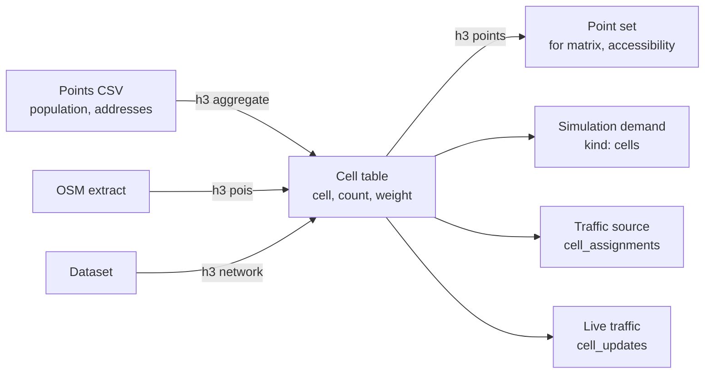

# H3 cells

This guide shows how to use [H3](https://h3geo.org/) hexagonal cells as a
spatial layer: for population and POI distributions, for traffic by area and
for simulation demand and zones.

A cell is a 15-digit hexadecimal id such as `88196d85ebfffff`. The
resolution is a number from 0 (continents) to 15 (about 1 m²). Each cell has
seven children at the next resolution.

| Resolution | Average area | Typical use |
| --- | --- | --- |
| 6 | 36 km² | Region |
| 7 | 5.2 km² | Town or district |
| 8 | 0.74 km² | Neighbourhood |
| 9 | 0.11 km² | Block |
| 10 | 0.015 km² | Street segment |



All cell work runs when you prepare or import data. Routing requests do not
use cells, thus cells do not change the speed of a request.

## Layers with more than one resolution

A layer can contain cells of different resolutions. When cells overlap, the
finest cell applies. Thus you can give a base value to a region with a few
coarse cells and then refine an area with fine cells:

```yaml
cell_assignments:
  - {cell: 86196d85fffffff, pattern: region}   # resolution 6: the region
  - {cell: 88196d85ebfffff, pattern: centre}   # resolution 8: one neighbourhood
```

Traffic cell assignments and the cell lookups of simulation zones follow
this rule. Live cell updates apply in the order of the request.

## Aggregate points into cells

`netweevil h3 aggregate` counts the points of a CSV in each cell, on one or
more resolutions. The CSV needs a longitude column and a latitude column.

```bash
netweevil h3 aggregate population.csv --resolutions 7,9 \
  --weight-column population --out population_cells.csv
```

| Flag | Default | Meaning |
| --- | --- | --- |
| `--resolutions` | required | Resolutions, separated by commas |
| `--lon-column`, `--lat-column` | `lon`, `lat` | Coordinate columns |
| `--weight-column` | none | Column to sum into `weight`. Without it, each point has the weight 1 |
| `--out` | required | Output file |

The output has one row for each cell of each resolution:

```csv
cell,resolution,count,weight
87196d85effffff,7,412,10250.0
89196d85ea7ffff,9,37,880.0
```

The extension of `--out` selects the format. This applies to all `h3`
commands that write cells:

| Extension | Format |
| --- | --- |
| `.csv` | Table with `cell`, `resolution` and the value columns |
| `.geojson` | `FeatureCollection` with one hexagon for each cell, for QGIS or a web map |
| `.json` | List of `{cell, resolution, ...}` objects |

`POST /v1/h3/aggregate` does the same for points in a request body. Add
`?format=geojson` to get hexagons.

## Count POIs and amenities

`netweevil h3 pois` reads an OSM extract. It counts the nodes and ways that
have a tag key, in each cell. A way counts at the mean position of its nodes.

```bash
netweevil h3 pois groningen-latest.osm.pbf --key amenity \
  --values school,kindergarten --resolutions 8 \
  --out schools.geojson --points-out schools.csv
```

| Flag | Default | Meaning |
| --- | --- | --- |
| `--key` | `amenity` | Tag key, for example `amenity`, `shop`, `leisure` or `office` |
| `--values` | all | Tag values to keep, separated by commas |
| `--resolutions` | required | Resolutions, separated by commas |
| `--out` | required | Output file with the counts |
| `--points-out` | none | Point-set CSV (`id,lon,lat,value,name`) of the POIs |

The file from `--points-out` is a point set. You can use it as the
destinations of `analyze matrix` or of an accessibility category.

!!! note
    Use the original OSM extract. An extract that contains only roads has no
    POIs.

## Summarize the network

`netweevil h3 network` counts the nodes and the directed edges of a dataset
in each cell. An edge counts in the cell of its midpoint.

```bash
netweevil h3 network --dataset groningen --resolution 8 --out network.geojson
```

The values are `node_count`, `edge_count` and `edge_length_m`. They show
where the network is dense, and which cells have no roads.
`GET /v1/h3/network?resolution=8` gives the same values for the loaded
dataset.

## Cover an area

`netweevil h3 cover` lists the cells whose centre is in a bounding box or in
a polygon.

```bash
netweevil h3 cover --bbox 6.50,53.18,6.62,53.25 --resolution 8 --out cells.csv
netweevil h3 cover --polygon district.geojson --resolution 9 --compact --out cells.json
```

`--polygon` reads the outer ring of the first polygon in a GeoJSON file.
`--compact` replaces each complete group of seven sibling cells by their
parent. The result then has mixed resolutions and fewer cells.

## Use cells in analyses

`netweevil h3 points` writes the centre of each cell as a point set. The
point id is the cell id.

```bash
netweevil h3 points population_cells.csv --out origins.csv
netweevil analyze accessibility --dataset groningen \
  --profile examples/profiles/cycling_north_nl_2026_05.yml \
  --request accessibility.json
```

Use the point set as the origins of a matrix, an OD batch, a service area or
an accessibility request. The ids in the result are cell ids. Thus you can
join the result to the cell table, for example to weight a travel time by
the population of the origin cell.

A cell table with mixed resolutions holds each point more than once. Filter
the table to one resolution before you use it as a point set.

## Change the resolution

`netweevil h3 resample` moves a weighted cell table to one resolution.

```bash
netweevil h3 resample population_cells.csv --resolution 7 --out population_r7.csv
```

A finer cell adds its weight to its parent. A coarser cell divides its
weight equally between its children. The total weight does not change.

## Traffic by cell

A traffic source can assign a speed pattern to the cells of an area. See
[Assign patterns by H3 cell](traffic.md#assign-patterns-by-h3-cell). The
live API can close or slow the roads of cells. See
[Live updates by H3 cell](traffic.md#live-updates-by-h3-cell).

## Simulation demand and zones

A fleet can sample its origins or destinations from weighted cells. The
weight is, for example, the population of the cell for origins and the
number of jobs for destinations. A zone can be a list of cells. See
[the scenario document](simulation.md#fleets).

`examples/requests/simulation_h3_cells.yml` is a scenario with cell demand
and a slow zone of cells.

## Related pages

- [Traffic](traffic.md)
- [Simulation](simulation.md)
- [Batch analysis](batch-analysis.md)
- [CLI reference](../cli/reference.md)
