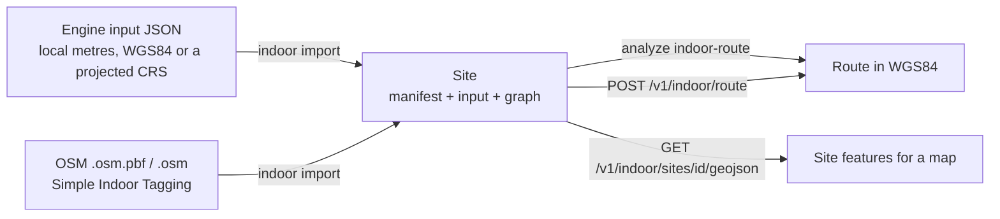

# Indoor routing

This guide shows how to import an indoor site, route inside it, and show it
on a map. An indoor site is a building, a station or a campus that the
[indoor engine](../concepts/indoor-routing.md) routes on. A workspace can
hold many sites. Indoor routes need no street dataset.



## Sites and anchors

The indoor engine works in metres. A site has an **anchor**: a longitude and
a latitude for the origin of its coordinates, and an optional rotation. The
anchor defines a local tangent plane. NetWeevil converts between the site
metres and WGS84 with it. The conversion is exact in both directions: a
point converted to WGS84 and back moves by less than 1 mm over 5 km.

| Anchor field | Meaning |
| ------------ | ------- |
| `lon`, `lat` | WGS84 position of the site point `(0, 0)`. |
| `rotation_deg` | Angle from east to the site x axis, counter-clockwise, in degrees. Default `0`: x points east and y points north. |
| `elevation_m` | Height of the site `z = 0`. Output `z` is this value plus the engine `z`. Default `0`. |

## Entrances

Entrances join a site to the street network. An entrance is a portal, a
node or a POI that has the tag `entrance`, or a portal of kind `entrance`.
The import records each entrance with:

- its position and level,
- its **outdoor side**: the point where it meets the streets,
- `step_free`: the `step_free` value of the portal.

The outdoor side of a portal is the side that is not on an indoor surface.
An indoor surface has walls or has the tag `indoor`. When both sides or no
side is on an indoor surface, the side farther from the site centre is the
outdoor side. A node or a POI is its own outdoor side. To set the outdoor
side yourself, give the element `props.outdoor` as `[x, y]` in site metres.

A site without entrances works for indoor routes, but street routes cannot
enter it.

## Import a site

```bash
netweevil indoor import <SOURCE> --name <SITE_ID> [--label TEXT]
    [--anchor LON,LAT] [--rotation DEG] [--elevation M]
    [--crs EPSG:CODE] [--bbox MIN_LON,MIN_LAT,MAX_LON,MAX_LAT]
```

The import compiles the site, finds its entrances and prints the counts,
the entrances and the compile warnings. A second import with the same name
replaces the site.

### Engine input in local metres

The [input schema](../concepts/indoor-routing.md#input-schema) describes
the document. Give the anchor of the site:

```bash
netweevil indoor import examples/indoor/demo_site.json --name demo \
  --label "Demo building" --anchor 6.5665,53.2194
```

### Engine input in WGS84

Set `"crs": "EPSG:4326"` in the document and give coordinates as
`[lon, lat]`. The anchor is the centre of the bounding box of the
coordinates. `--anchor` replaces it.

### Engine input in a projected CRS

Give the CRS with `--crs` or with the `crs` field of the document. The CRS
is `EPSG:<code>` from the built-in table (UTM zones, RD New `EPSG:28992`,
British National Grid `EPSG:27700`, Hong Kong 1980 `EPSG:2326`, Web Mercator
`EPSG:3857`) or a `+proj=` definition. The anchor is the centre of the
coordinates.

```bash
netweevil indoor import campus_rd.json --name campus --crs EPSG:28992
```

### OpenStreetMap with Simple Indoor Tagging

The importer reads `.osm.pbf` and `.osm` (XML) files. It puts all indoor
features of the file into one site. Use `--bbox` to select one building
from a larger extract.

```bash
netweevil indoor import station.osm.pbf --name station \
  --bbox 6.5630,53.2095,6.5660,53.2115
```

| OSM | Site element |
| --- | ------------ |
| `indoor=room` (closed way or multipolygon) | Surface with walls, class `room`. |
| `indoor=corridor` | Surface with walls, class `corridor`. |
| `indoor=area` | Open surface without walls, class `area`. |
| `door=*`, `indoor=door`, `entrance=*` on the outline of a room, corridor or area | Portal across the outline. `width` sets the width (default 0.9 m, 1.2 m for an entrance). `wheelchair=no` or `door=revolving` makes the portal not step-free. `entrance=*` makes it a site entrance. |
| `highway=corridor\|footway\|path\|steps\|pedestrian` with `level` or `indoor=yes` | Edge. Steps are not step-free. A way on two or more levels is a vertical (stairs, ramp or escalator) from its first level to its last level. `incline=down` reverses the direction. |
| `highway=elevator` node with two or more levels | Lift with a stop on each level. |
| `highway=elevator` or `stairwell=*` area | A room on each level, and a lift or stairs at its centre. |
| `conveying=*` | On steps: an escalator (`forward` moves along the way, `backward` against it). On a flat way: a travelator edge at 2 m/s. |
| `indoor=wall`, `barrier=*` with `level` | Barrier. |
| Rooms with `name` or `ref`, `amenity=*`, `shop=*`, `office=*` with `level` | POI. Route to it by its name or ref. |

Levels:

- `level` and `repeat_on` give the levels. The importer accepts lists
  (`0;1`), ranges (`1-3`, `-2--1`), negative and fractional levels (`-1`,
  `0.5`). It repeats a feature on each of its levels.
- Level `n` has the height `z = n × storey height`. The storey height is
  `height / building:levels` of the building around the site centre when
  the building has both tags. Otherwise it is 3.5 m.
- The level id is the number (`0`, `1`, `-1`, `0.5`).

Element ids are the OSM ids (`w123`, `n45`, `r6`). A feature on several
levels has the id `w123@1` on level 1. Each element keeps its OSM id and
all its tags in `props`.

Doors that are not on the outline of a room, a corridor or an area on their
level are skipped. The import prints how many.

## Manage sites

```bash
netweevil indoor list
netweevil indoor show demo       # manifest: anchor, levels, entrances, counts
netweevil indoor remove demo
```

Sites are stored in `.netweevil/indoor_sites/<site_id>.json` and
`.netweevil/bundles/indoor/<site_id>/` (the input in site metres and the
compiled graph).

## Route inside a site

A request names the site, two points, a profile and an optional mode:

```json
{
  "route_id": "workshop-to-1.14",
  "site_id": "demo",
  "origin": {"poi": "Workshop"},
  "destination": {"poi": "1.14"},
  "profile": "wheelchair",
  "mode": "mixed"
}
```

| Field | Meaning |
| ----- | ------- |
| `origin`, `destination` | A point: `{lon, lat, level}`, `{poi}` or `{space}`. |
| `lon`, `lat` | A position in WGS84. |
| `level` | A level id (`"1"`) or a level number (`1`, `-1`, `0.5`). Without a level, the point snaps to the nearest level. |
| `poi` | A POI id, or the `name` or `ref` of a POI. The match ignores case. When several POIs match, the route goes to the best one. |
| `space` | A space id, or the name or ref of a POI. |
| `profile` | A built-in indoor profile (`walk`, `wheelchair`, `fastest`, `bike`, `evacuation`) or a profile object. Default `walk`. |
| `mode` | `mixed`, `edges_only` or `surfaces_only`. It replaces the mode of the profile. |

Run it with the CLI:

```bash
netweevil analyze indoor-route --request examples/indoor/indoor_route_request.json \
  --out route.json
```

`--out route.geojson` writes one line feature for each segment.

Or with the API:

```bash
curl -X POST 'http://127.0.0.1:8080/v1/indoor/route?format=geojson' \
  -H 'content-type: application/json' \
  --data @examples/indoor/indoor_route_request.json
```

The result has:

| Field | Meaning |
| ----- | ------- |
| `summary` | `duration_s`, `length_m`, `climb_m`, `descent_m` and `cost` (seconds weighted by the profile). |
| `geometry` | `[lon, lat, z]` points. `z` is metres above the base of the site. |
| `segments` | One entry for each walk, edge, portal, vertical and connector: `type`, `kind`, `id`, `level`, `space`, `class`, `length_m`, `duration_s`, `props`, and the index range in `geometry`. |
| `spaces` | The spaces that the route crosses, in order. |
| `origin_poi`, `destination_poi` | The POIs that the route starts or ends at. |
| `warnings` | Warnings of the engine. |

## Show a site on a map

`GET /v1/indoor/sites` lists the sites. `GET /v1/indoor/sites/{site_id}`
sends the manifest. `GET /v1/indoor/sites/{site_id}/geojson?level=1` sends
the site elements of one level as GeoJSON. Each feature has the property
`feature_type`: `surface`, `barrier`, `edge`, `portal`, `vertical`, `node`,
`poi` or `entrance`.

The API loads a site when a request first uses it. It reloads the site
after a new import.

## Door-to-door routes

A door-to-door route goes from a street point or an indoor point to another
street point or indoor point. It joins up to three legs: an indoor leg out of
the origin site, a street leg, and an indoor leg into the destination site.
At least one end must be indoors.

```json
{
  "route_id": "station-to-room-1.14",
  "origin": {"lon": 6.5641, "lat": 53.2108},
  "destination": {"site_id": "demo", "poi": "1.14"},
  "indoor": {"profile": "wheelchair", "entrance_snap_m": 50}
}
```

| Field | Meaning |
| ----- | ------- |
| `origin`, `destination` | A street point `{lon, lat}`, or an indoor point: `{site_id, lon, lat, level}`, `{site_id, poi}` or `{site_id, space}`. A point with a `level` and no `site_id` is in the site whose footprint contains it. |
| `indoor.profile`, `indoor.mode` | The indoor profile and mode of the indoor legs. Default `walk`. |
| `indoor.entrance_snap_m` | The outdoor side of an entrance must be within this distance of a street that the street profile can use. Default 50 m. |
| `indoor.max_entrances` | Entrances compared on each indoor side. Default and maximum 8. |
| `snap` | Snap options of street ends, as in a route request. |

### How the entrances are chosen

1. For an indoor origin, one indoor search gives the travel time from the
   point to each entrance of its site. For an indoor destination, the
   travel time from each entrance to the point.
2. Entrances that the indoor profile cannot reach or pass are dropped. A
   step-free profile does not use an entrance that is not step-free.
3. The 8 entrances with the least indoor travel time are kept on each side.
4. The outdoor side of each entrance snaps to the street graph. Entrances
   that do not snap are dropped with a warning.
5. One many-to-many street query gives the street travel time between all
   candidates. When each side has one candidate, one route is used.
6. The pair with the least `indoor out + street + indoor in` travel time
   wins. Only this pair is routed with geometry.

The choice is by travel time of both engines. The street leg keeps the
generalized cost of the street profile, reported in
`summary.street_generalized_cost`. The choice is exact over the candidates.
An entrance outside the 8 fastest indoor entrances is not compared.

When both ends are in the same site, the result is the indoor route alone
when it is no slower than leaving the site and entering again.

Run it with the CLI. The street dataset and profile are those of
`analyze route`:

```bash
netweevil analyze door-to-door --dataset groningen \
  --profile examples/profiles/pedestrian_research_v1.yml \
  --request examples/indoor/door_to_door_request.json --out d2d.geojson
```

Or with the API. Choose the street profile with `profile_id` (or `profile`
and `profile_overrides`) as in `POST /v1/route`:

```bash
curl -X POST 'http://127.0.0.1:8080/v1/door-to-door/route?format=geojson' \
  -H 'content-type: application/json' \
  --data @examples/api/door_to_door.json
```

The result has:

| Field | Meaning |
| ----- | ------- |
| `legs` | The legs in travel order. Each leg has `leg_type` (`indoor` or `street`), `duration_s`, `length_m`, `geometry` (`[lon, lat, z]`) and its own result: `indoor` (an indoor route result) or `street` (a street route result). |
| `origin_entrance`, `destination_entrance` | The entrances used, with `indoor_duration_s` and `snap_distance_m`. |
| `summary` | `duration_s`, `length_m`, `indoor_duration_s`, `street_duration_s`, `street_generalized_cost` and the number of candidates on each side. |
| `warnings` | For example, entrances that are too far from a street. |

The GeoJSON output has one line feature for each leg with the property
`leg_type`.
