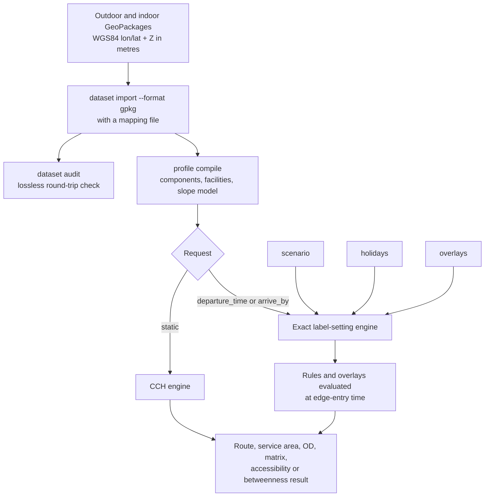

# Multilayer and temporal routing

This guide shows how to import a lossless 3D pedestrian network from
GeoPackages and route on it with time-dependent rules. It covers:

- source preparation and mapping files;
- slope- and facility-aware profiles with named cost components;
- scenarios, holiday calendars and continuous overlays;
- OSM conditional tags;
- component budgets and Pareto routes.

The engine is geography-neutral. A mapping file defines what the source
fields mean. Scenario, calendar and overlay files define the changing
conditions.



!!! note
    The files under `examples/` are executable schema examples. Values and
    source feature ids whose names start with `hk_example`, `illustrative` or
    `DEMO` are Hong Kong-shaped examples only. They are not built-in network
    behavior. Replace them with ids and coordinates from your dataset.

## Prerequisites

- GDAL (`ogr2ogr`, `ogrinfo`) for source preparation.
- Source networks as GeoPackages, or as FileGDB exports that you convert.
- For the full Hong Kong example, see the
  [Hong Kong tutorial](hong-kong-tutorial.md).

## Prepare the source data

GeoPackage ingest does no projection. Each input must contain longitude and
latitude in WGS84 order, and a Z coordinate in metres. All inputs must use
one vertical datum.

!!! warning
    NetWeevil does not read a raw Hong Kong 1980 Grid network in EPSG:2326.
    It does not transform HKPD heights from EPSG:5738. It does not read a
    FileGDB directly. Do not pass projected eastings and northings to
    `dataset import`. The importer expects geographic coordinate ranges and
    does no hidden reprojection.

For the Hong Kong analysis, the preparation must do these steps:

1. Export the outdoor and indoor FileGDB layers to GeoPackage.
2. Transform horizontal coordinates from EPSG:2326 to WGS84 longitude and
   latitude.
3. Keep or derive Z in metres in the chosen vertical datum (HKPD for the
   project). Use that datum in every source.
4. Keep every source vertex and field.
5. Make the feature-id namespaces disjoint across the files.

The repository includes a validated GDAL workflow for the outdoor and indoor
GeoPackages:

```bash
scripts/prepare_hong_kong_pedestrian.sh \
  /path/to/hk-sources
```

The script does these steps:

1. It reads the two files under `datasets/` of the source directory.
2. It transforms only the EPSG:2326 horizontal coordinates to WGS84. It keeps
   the third coordinate as EPSG:5738 HKPD metres.
3. It checks feature counts, field names, types and domains, geographic
   bounds and a sampled Z value.
4. It installs each output atomically under `prepared/`, with the same base
   names and layer names.
5. It writes `prepared/netweevil-preprocessing-manifest.txt` with the SHA-256
   checksums of the sources and the GDAL transformation details.

| Option | Effect |
| --- | --- |
| `--output-dir DIR` | Writes to another directory |
| `--check-only` | Validates GDAL and the sources. Writes no files |
| `--force` | Replaces existing prepared GeoPackages |

Portals weld only when the transformed `(lon, lat, z)` coordinates quantize
to the same values. The example tolerances are `1e-9` degrees and `0.01` m.
Transform coincident indoor and outdoor portal coordinates with the same
deterministic transformation. Do not snap them independently.

## Map and import GeoPackages

A mapping file tells the importer which source fields have which meaning.

- `examples/ingest/multilayer_walkways_mapping.yml` shows a generic
  version-1 mapping.
- `examples/ingest/hong_kong_pedestrian_mapping.yml` uses the Hong Kong
  source schemas: `pedestrian_route` and `indoor_pedestrian_route`, geometry
  column `Shape`, and `PedestrianRouteID` as the feature id. It maps
  `FeatureType`, `WeatherProof`, `Location`, `Enabled`, the wheelchair
  fields, `access_time_details`, `access_time_type`, and the grouping and
  name columns. It keeps all other fields.

### Mapping roles

Each mapped layer needs a `feature_id` role. Other useful roles are
`direction`, `class` or `feature_type`, `covered`, `indoor_location`,
`enabled`, `wheelchair_access`, `wheelchair_barrier`, `access_schedule`, a
schedule-polarity role, names and grouping ids. Profile rules can use the
original source column name or its semantic role.

`retain: all` is required. The importer stores all non-geometry source fields
in the typed feature-attribute table. It keeps coded-value domains from the
GeoPackage. Mapping-level `decode` entries can add or replace values for
matching.

The importer splits source polylines at every vertex. Each derived edge keeps
its source feature row and source feature id. The importer also keeps compact
metadata:

- part boundaries;
- positions of consecutive vertices that collapse under coordinate
  quantization;
- sparse exact-coordinate overrides where a welded vertex differs from its
  canonical node;
- part anchors without edges;
- the source-layer schema of each row.

With the source-oriented edge order, this metadata keeps the MultiLineString
structure and repeated vertices. It does not duplicate the geometry buffer. It
also detects a field that disappears from only one input layer.

### Direction values

Direction values decode to `forward`, `reverse` or `both`. If a scenario can
reverse a one-way feature at runtime, list its source id under
`materialize_both_directions_for` before import. Then both directed edges
exist.

### Access schedules

An `access_schedule` source cell is a JSON array:

```json
[
  {"day_code":"WD","from_time":600,"to_time":2359},
  {"day_code":"PH","from_time":"10:00","to_time":"18:00"}
]
```

- Day codes include `ED`, single weekdays, `WD`, `WE` and `PH`.
- `OPEN` polarity closes the feature outside the listed intervals. `CLOSE`
  polarity closes it inside them.
- `2400` and `2359` both mean the end of the day.
- An end earlier than the start wraps across midnight.

### Hong Kong source values

The published Hong Kong files are `3D_Pedestrian_Network.gpkg` and
`3D_Indoor_Network.gpkg`. Keep those base names, layer and field names, coded
domains and vertices in the prepared outputs. Then the mapping and the audit
describe the source correctly. The coded values include:

- `FeatureType` facilities and their `M_` variants. The mapping makes both
  variants match the same profile class.
- `WeatherProof` 1, 2 and 3 as covered, not covered and unclassified.
- `Location` 1 and 2, plus indoor value 3 for paid area.
- Wheelchair booleans encoded as 1 and 2.
- `Direction` -1, 0 and 1.

### Import

Import the prepared outdoor and indoor sources into one topology:

```bash
cargo run -p netweevil-cli -- dataset import \
  /path/to/hk-sources/prepared/3D_Pedestrian_Network.gpkg \
  /path/to/hk-sources/prepared/3D_Indoor_Network.gpkg \
  --name hk_pedestrian_3d \
  --format gpkg \
  --mapping examples/ingest/hong_kong_pedestrian_mapping.yml
```

The `source:` selectors in the mapping must match the input file names or
path suffixes. The importer rejects duplicate feature ids across sources.
Import progress reports feature, segment-chain and welded-node counts.

### Audit the import

Run the lossless round-trip audit against the same sources and mapping:

```bash
cargo run -p netweevil-cli -- dataset audit \
  --dataset hk_pedestrian_3d \
  --against \
    /path/to/hk-sources/prepared/3D_Pedestrian_Network.gpkg \
    /path/to/hk-sources/prepared/3D_Indoor_Network.gpkg \
  --mapping examples/ingest/hong_kong_pedestrian_mapping.yml \
  --json
```

The audit reads the sources again. It fails on:

- missing or unexpected features or fields;
- drift in type, semantic role or domain;
- drift in retained values;
- drift in source-oriented vertex or part order;
- missing or unexpected quantized 3D segments.

!!! note
    The audit does not replace project-specific portal QA. Count the shared
    indoor and outdoor portal vertices separately in your preparation
    pipeline. Compare that count with your audited expectation. That number
    is a dataset check, not an engine constant.

## Compile pedestrian profiles

Two complete profiles are available:

- `examples/profiles/pedestrian_multilayer.yml` uses the Tobler slope
  adjustment, stairs, escalators, lifts, travelators and ramps. It has named
  exposure, ascent and facility components.
- `examples/profiles/pedestrian_step_free_multilayer.yml` excludes barriers,
  stairs and escalators. It uses a piecewise slope model and prices lift and
  ramp traversal.

### Cost components

The engine accumulates components next to the scalar generalized cost. An
expression has one base quantity (`travel_time`, `distance`, `ascent`,
`descent` or `zero`), optional attribute predicates, and at most one temporal
overlay term:

```yaml
components:
  uncovered_time:
    expression: "travel_time * (covered == false)"
    weight: 0.25
  sun_time:
    expression: "travel_time * (covered == false) * (1 - overlay:shade_fraction)"
    weight: 0.50
```

- Component weights add to the scalar objective.
- A zero weight records a quantity without a change to the route choice.
- Facility components such as `lift_wait` can use the expression `zero`. The
  facility model supplies their edge values.

### Validate and compile

```bash
cargo run -p netweevil-cli -- profile validate \
  examples/profiles/pedestrian_multilayer.yml

cargo run -p netweevil-cli -- profile compile \
  --dataset hk_pedestrian_3d \
  --profile examples/profiles/pedestrian_multilayer.yml
```

Validation checks the profile document. Compilation also rejects a matcher,
facility attribute or component predicate that is not in the original-column
and semantic-role registry of the dataset.

### Hong Kong profile notes

- Both profiles exclude `enabled=false`.
- The Hong Kong `WheelchairAccess` field identifies an accessible entrance.
  The profiles keep it for reports and entrance selection. It is not a
  general edge-passability flag. The step-free profile excludes
  `wheelchair_barrier=true` and stair and escalator facilities. It does not
  delete every link whose `wheelchair_access` value is false.
- The mapping decodes `WeatherProof=3` as `covered=unknown`. The profiles
  report that time separately as `coverage_unknown_time`, with zero weight.
  Thus an analysis can publish covered and uncovered sensitivity bounds. It
  does not assign the unclassified links silently.

The profiles allow paid-area links for platform and door-to-door transit
work. For a street-only analysis that must not cross a fare gate, add an
exclusion:

```yaml
exclude_rules:
  - match:
      indoor_location: paid_area
```

## Temporal requests, scenarios and overlays

Route, OD, matrix, service-area, accessibility and betweenness requests can
carry flat temporal fields. Requests carry content only. The API and the
engine never open a file that a request names.

| Field | Meaning |
| --- | --- |
| `departure_time` or `arrive_by` | RFC 3339 time. The two forms are mutually exclusive |
| `scenario` | One inline feature-state overlay: `{id, features: [{source_feature_id, force_closed, rules, ...}]}` |
| `holidays` | List of `YYYY-MM-DD` public-holiday dates |
| `overlays` | List of inline continuous series: `{id?, rows: [{feature_id, t_start, t_end, <value_name>: number, ...}]}`. Later overlays take precedence |
| `max_labels_per_state` | Guard for the exact search. Default 16 |
| `arrive_by_lookback_s` | Search window before an `arrive_by` time. Default 86400 |

A time without an offset is read in the local time zone of the network. See
[Regions and elevation](regions-and-elevation.md#time-zones).

### Local files in CLI request documents

A request document that the CLI reads can reference local files. The CLI
loads them and inlines them before execution. Relative paths resolve against
the directory of the document.

| Field | Inlined as |
| --- | --- |
| `scenario_file` | `scenario` (YAML or JSON scenario overlay) |
| `holiday_calendar_file` | Appended to `holidays`. YAML or JSON: a bare list or `{dates: [...]}` |
| `overlay_files` | Appended to `overlays`. CSV or Parquet series |

### CLI flags

The `route`, `directions`, `route-batch`, `od`, `matrix`, `accessibility`,
`service-area`, `service-area-sequence` and `betweenness` commands accept
`--departure-time`, `--scenario`, `--holiday-calendar` and repeatable
`--overlay` flags. The CLI reads the files.

- A scalar flag replaces only the matching request-file value. Other fields
  do not change.
- `--holiday-calendar` replaces the request holidays.
- CLI overlays append after the request-file overlays. Later entries take
  precedence.
- An explicit `--departure-time` replaces an `arrive_by` anchor.
- Each CLI run manifest stores the merged request under
  `effective_request`. Thus the overrides are reproducible without a change
  to the source request file.

```bash
cargo run -p netweevil-cli -- analyze route \
  --dataset hk_pedestrian_3d \
  --profile examples/profiles/pedestrian_multilayer.yml \
  --request examples/requests/hong_kong_example_temporal_route.json \
  --departure-time 2026-07-10T09:55:00+08:00 \
  --scenario examples/scenarios/hong_kong_central_escalator_example.yml \
  --holiday-calendar examples/temporal/example_holidays.yml \
  --overlay examples/temporal/shade_fraction.csv
```

For a matrix, the overrides apply to the point set that already carries
temporal options (origins by default). When both sides are active, the CLI
applies identical options to both. For `service-area-sequence`, see
[Service areas](service-areas.md#service-area-sequences).

### How temporal searches work

- Scenarios and continuous overlays require `departure_time` or `arrive_by`.
- Temporal searches evaluate each rule and overlay at edge-entry time. They
  use the exact label-setting engine. Static requests can use the CCH.
- Waiting at a closed edge is allowed only when the compiled profile sets
  `temporal.allow_wait: true`. `max_wait_s` limits the wait.
- Time-varying `SpeedFactor` rules work with or without a wait policy. The
  exact engine takes the earliest-exit lower envelope across the current and
  future minute regimes.
    - With `allow_wait`, that includes a voluntary wait of up to `max_wait_s`
      when it arrives sooner.
    - Without it, the engine admits a later entry only when it exits no later
      than an immediate entry. The vehicle approaches the edge more slowly.
      This keeps each edge FIFO and never waits at a closed edge.
- Thus conditional speed limits (`maxspeed:conditional`) work in
  departure-time routing for every profile.

!!! warning
    An overlay component can be nonzero on a speed-varying feature where the
    loaded series defines that component. Then the request fails. Fastest
    exit and lowest exposure can be nondominated choices. Model those
    alternatives explicitly.

## OSM conditional tags

OSM imports turn `:conditional` tags with an `opening_hours` time domain into
temporal rules for the travel modes that they name. The engine reads the
rules on the local clock of the edge's time zone.

- **Conditional access.** `motor_vehicle:conditional=no @ (Mo-Fr 07:00-09:00)`
  closes the edge for those modes in that window. Some edges allow a mode
  only under a condition, for example `access=no` with
  `...:conditional=yes @ (...)`. Static routing and the hierarchy leave such
  an edge out. Time-dependent searches open it when the condition holds.
- **Conditional speed.** `maxspeed:conditional` becomes a posted-speed rule.
  Each profile compiles it into its own speed factor, with the same
  posted-limit policy as the static speed.
- **Conditional turn restrictions.** `restriction:conditional` and its
  mode-specific forms make turn restrictions time-conditional.
    - Static routing ignores a restriction tagged only under a condition.
    - An unconditional `restriction` that a condition lifts
      (`restriction:conditional=none @ (Sa,Su)`) stays in static routing.
    - Time-dependent searches check restrictions between two edges (via a
      node) at the moment that the vehicle reaches the junction. They use the
      local clock of the incoming edge. This applies to departure and
      arrive-by routes, component-constrained routes, service areas,
      accessibility, and the temporal OD, matrix, sequence and betweenness
      paths.
    - A vehicle does not wait at a junction for a restriction to lift.
    - Arrive-by searches split their exit windows at the minutes when a
      restriction starts and ends. Thus the latest departure stays exact.
    - Restrictions over a via way keep their static treatment in all
      searches.
- **Vehicle conditions.** Conditions on vehicle properties
  (`no @ (weight>7.5)`) become vehicle restrictions. The engine checks them
  against the `vehicle` block of the profile or request, not against the
  clock. See [Routing](routing.md#vehicle-dimensions-weight-and-hazardous-goods).

## Scenario files

A scenario addresses source features, not internal edge ids:

```yaml
id: maintenance
features:
  - source_feature_id: 900002
    force_closed: true
  - source_feature_id: 900003
    speed_factor: 0.5
```

A feature entry can also:

- set `force_open`;
- replace imported rules;
- add rules with the effects `closed`, `open_only`, `forward_only`,
  `backward_only` or a serialized `speed_factor`.

Rule intervals use an inclusive `start_minute` and an exclusive `end_minute`.
A start after the end wraps across midnight. Day-mask bits are Monday to
Sunday (`1` to `64`) plus public holiday (`128`).

!!! note
    On a date in the holiday calendar, the PH bit replaces the weekday bit.
    Use mask `255` when a rule must cover weekdays and holidays.

`examples/scenarios/generic_asset_failure.yml` is a generic example.

### Hong Kong escalator example

`examples/scenarios/hong_kong_central_escalator_example.yml` uses the audited
`PedestrianRouteID=250009423` as a runtime direction override. Its geometry
is digitized uphill.

`examples/scenarios/hong_kong_central_mid_levels_source_features.csv` keeps
all 33 related source features selected for bidirectional materialization,
with their source `Direction` and `access_time_details` values. That
inventory reflects the source snapshot of July 2026. The snapshot has
separate scheduled-direction features, so imported schedules can already
encode the operating pattern. The scenario shows replacement at runtime.

!!! warning
    Audit ids, geometry direction and schedules again after each source
    refresh.

## Continuous overlays

A continuous overlay supplies time-varying values per feature, for example
shade or heat.

- The required columns are `feature_id`, `t_start` and `t_end`.
- Each other non-empty column is a numeric value. Profiles read it as
  `overlay:<column>`.
- Times are RFC 3339. Intervals include the start and exclude the end.

See `examples/temporal/shade_fraction.csv`.

!!! note
    NetWeevil uses shade or heat series that you calculate externally. It
    does not calculate solar geometry.

## Run a temporal route

1. Change the coordinates and feature ids of the example to match your
   dataset.
2. Run the route:

    ```bash
    cargo run -p netweevil-cli -- analyze route \
      --dataset hk_pedestrian_3d \
      --profile examples/profiles/pedestrian_multilayer.yml \
      --request examples/requests/hong_kong_example_temporal_route.json \
      --out .netweevil/runs/hk-example-temporal-route.geojson
    ```

The Z values of the example points and `snap.z_window_m` prevent snaps across
stacked levels. `snap.attribute_filters` can also limit candidates to a
semantic or source attribute value.

## Component budgets and Pareto routes

A route request can add hard component budgets and a two-objective frontier:

```json
{
  "constraints": [{"component":"uncovered_time","max_value":300.0}],
  "pareto": {
    "component":"uncovered_time",
    "max_routes":8,
    "max_labels_per_state":96
  }
}
```

| Field | Default | Meaning |
| --- | --- | --- |
| `constraints[]` | `[]` | `{component, max_value}`. Hard budget on a named component |
| `pareto.component` | required | Component for the second objective |
| `pareto.max_routes` | 16 | Largest number of returned routes |
| `pareto.max_labels_per_state` | 64 | Label limit per search state |

Run the full fixture:

```bash
cargo run -p netweevil-cli -- analyze route \
  --dataset hk_pedestrian_3d \
  --profile examples/profiles/pedestrian_multilayer.yml \
  --request examples/requests/hong_kong_example_pareto_route.json \
  --out .netweevil/runs/hk-example-pareto.geojson
```

Component constraints and Pareto routing use exact nondominated
label-setting. They work for static routes and for temporal `departure_time`
or `arrive_by` requests. This includes scenario rules and continuous
component overlays at edge-entry time. The per-state label cap and the
returned-route cap limit worst-case growth.

!!! note
    Component constraints and Pareto routes require the strict fallback
    policy. They do not work with traffic data.

## Related analyses

- [Service areas](service-areas.md#service-area-sequences) for
  service-area sequences and component vectors.
- [Batch analysis](batch-analysis.md#calculate-edge-betweenness) for edge
  betweenness and scenario batches.
- [Transit](transit.md#stop-bindings) for stop bindings and network transfer
  tables.
- [Hong Kong tutorial](hong-kong-tutorial.md) for the full example with
  numbered MTR platform bindings.
- [HTTP API reference](../api/reference.md) for the full schema.
