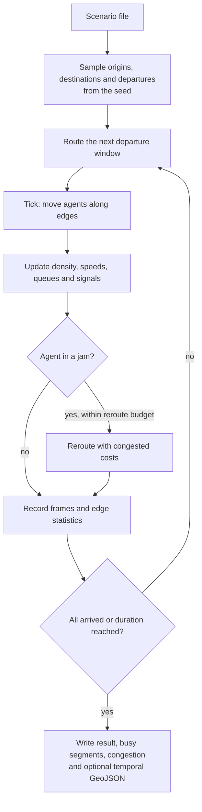

# Agent-based traffic simulation

The simulation moves fleets of agents over the directed edge graph of a
dataset. Each fleet uses one compiled profile. The engine is a mesoscopic
queue model:

- Each edge has a storage capacity (the PCU that fit on it) and an outflow
  capacity (PCU per second).
- Speeds drop with density (Greenshields or BPR).
- With `no_collision`, full downstream edges block transitions (spillback).
- Edges with traffic signals gate their outflow on a fixed cycle.
- Agents in a jam can reroute with live congested costs.

A run is deterministic for a given scenario, dataset, profiles and seed. The
CLI, the API and the QGIS plugin use the same scenario schema.



The engine plans all agents at the start, but it routes them in windows of
departures ahead of the clock. Thus the simulation starts at once.

## Prerequisites

- An imported dataset.
- A compiled profile for each fleet. Each fleet's `profile_id` must match a
  profile that you pass to the CLI or that the API loads.

## Run a simulation

=== "CLI"

    1. Validate the scenario:

        ```bash
        cargo run -p netweevil-cli -- simulate validate \
          examples/requests/simulation_scenario.yml
        ```

    2. Compile each profile that the fleets use.
    3. Run the scenario:

        ```bash
        cargo run -p netweevil-cli -- simulate run \
          examples/requests/simulation_scenario.yml \
          --dataset groningen_2026_05 \
          --profile examples/profiles/car_research_v1.yml \
          --profile examples/profiles/cycling_north_nl_2026_05.yml \
          --temporal-geojson \
          --out-dir .netweevil/runs
        ```

=== "HTTP"

    1. Start the API with the profiles of the fleets.
    2. Send `{"scenario": <scenario document as JSON>}` to
       `POST /v1/simulation`. The response has the `simulation_id` and the
       status.
    3. Watch the run with the frame, edge and status endpoints, or in the
       QGIS plugin's Simulation tab.

| Flag | Default | Meaning |
| --- | --- | --- |
| `<SCENARIO>` | required | Scenario file (YAML, TOML or JSON) |
| `--dataset` | required | Dataset id |
| `--profile` | none | Profile files. Repeat for each fleet profile |
| `--out-dir` | `.netweevil/runs` | Output directory |
| `--temporal-geojson` | off | Also writes a temporal GeoJSON of agent frames for the QGIS temporal controller |
| `--min-traversals` | 1 | Smallest number of traversals for an edge in the busy-segments output |

### Output files

For a scenario with id `<id>`, the CLI writes these files to the output
directory:

| File | Contents |
| --- | --- |
| `simulation-<id>-result.json` | Compact JSON result |
| `simulation-<id>-busy-segments.geojson` | Busy segments |
| `simulation-<id>-congestion.geojson` | Congestion |
| `simulation-<id>-temporal.geojson` | Agent frames, with `--temporal-geojson` |

The CLI also writes a run manifest. See
[Reports and experiments](reports-and-experiments.md).

## Scenario document

`examples/requests/simulation_scenario.yml` dispatches 600 cars and 300
bicycles over 30 simulated minutes. It has a slow zone in the city center and
standing background traffic in an area of the ring road.

### `scenario`

| Field | Default | Meaning |
| --- | --- | --- |
| `id` | required | Scenario id |
| `label`, `description` | empty | Text |
| `seed` | 1 | Random seed. The same seed gives an identical run |

### `time`

| Field | Default | Meaning |
| --- | --- | --- |
| `duration_s` | 3600 | Simulated horizon in seconds |
| `tick_s` | 1.0 | Engine tick. A smaller tick gives finer movement and a slower run |
| `stop_when_all_arrived` | `true` | Ends the run when all agents arrive |

### `fleets[]`

| Field | Meaning |
| --- | --- |
| `fleet_id` | Fleet id |
| `profile_id` | Compiled profile. The travel mode comes from the profile |
| `agent_count` | Number of agents |
| `demand` | Origins, destinations or explicit OD pairs |
| `departures` | Departure time distribution |
| `behavior` | Agent behavior |
| `speed` | Speed and acceleration |

`demand.origins` and `demand.destinations` take a `kind`:

| `kind` | Fields | Meaning |
| --- | --- | --- |
| `random_bounds` (default) | none | Uniform inside the dataset extent |
| `random_bbox` | `bbox: [min_lon, min_lat, max_lon, max_lat]` | Uniform inside a box |
| `random_polygon` | `polygon` | Uniform inside a WGS84 outer ring |
| `points` | `points: [{lon, lat, weight?, label?}]` | Weighted choice from fixed points |
| `zones` | `zone_ids` | Inside named `spawn` or `attract` zones, weighted |

`demand.od_pairs` is a list of `{origin: [lon, lat], destination: [lon,
lat]}`. Explicit pairs replace origins and destinations. The engine cycles
them when there are fewer pairs than agents.

`departures` take a `kind`:

| `kind` | Fields | Meaning |
| --- | --- | --- |
| `uniform` (default `0` to `600`) | `start_s`, `end_s` | Uniform in `[start_s, end_s)` |
| `peak` | `mean_s`, `std_s` | Normal distribution around a peak, clamped at zero |
| `instant` | `at_s` | All agents at one instant |
| `poisson` | `start_s`, `rate_per_s` | Poisson arrivals |

`behavior` values are fleet means. Each agent varies them deterministically
by `heterogeneity`.

| Field | Default | Meaning |
| --- | --- | --- |
| `overtake_eagerness` | 0.4 | 0 to 1. How much of its desired speed an agent keeps in moderate congestion |
| `reroute_eagerness` | 0.3 | 0 to 1. Probability that an agent reroutes in a jam |
| `jam_speed_threshold` | 0.4 | Speed fraction of free flow that counts as a jam |
| `reroute_cooldown_s` | 120 | Minimum time between reroutes of one agent |
| `obey_traffic_signals` | `true` | Stops at red signals |
| `alternative_route_share` | 0.25 | 0 to 1. Share of agents that start on a ranked alternative route |
| `max_alternatives` | 3 | Alternatives requested at dispatch |
| `no_collision` | `true` | Enforces storage capacity, queues and spillback. Set `false` for ghost flows |
| `heterogeneity` | 0.15 | 0 to 1. Relative variation per agent |

!!! note
    An alternative search costs about ten times more than a plain route.
    With fully random demand, each agent is a unique pair. Thus a high
    `alternative_route_share` makes dispatch slow. Demand with shared
    endpoints (points, zones or OD pairs) shares this cost per unique pair.

`speed`:

| Field | Default | Meaning |
| --- | --- | --- |
| `speed_multiplier_mean` | 1.0 | Mean multiplier on profile speeds |
| `speed_multiplier_std` | 0.08 | Standard deviation of the multiplier |
| `max_speed_kph` | none | Hard speed limit |
| `acceleration_mps2` | 2.0 | For the trapezoidal position model and spawn ramp-up |
| `deceleration_mps2` | 2.5 | For the trapezoidal position model |
| `pcu` | by mode | Passenger-car units of one vehicle: car and taxi 1.0, HGV and bus 2.0, motorcycle 0.5, moped and bicycle 0.3, foot 0.1 |

### `zones[]`

A zone is a WGS84 polygon with an effect. You can draw zones in QGIS or write
them in the scenario file.

| Field | Meaning |
| --- | --- |
| `zone_id` | Zone id |
| `label` | Text |
| `polygon` | Outer ring as `[lon, lat]` pairs, open or closed |
| `effect` | See the effect kinds |

| Effect `kind` | Fields | Meaning |
| --- | --- | --- |
| `no_access` | `modes` | Closes edges inside for the listed modes. An empty list closes them for all modes |
| `speed_factor` | `factor` | Multiplies edge speeds inside |
| `capacity_factor` | `factor` | Multiplies storage and flow capacity inside, for example lane closures |
| `high_traffic` | `background_load` | Standing background traffic as a fraction (0 to 1) of storage capacity |
| `spawn` | `weight` | Origin sampling zone for `zones` demand |
| `attract` | `weight` | Destination sampling zone for `zones` demand |

### `traffic`

| Field | Default | Meaning |
| --- | --- | --- |
| `model` | `greenshields` | `greenshields`: `v = v_free * max(min_speed_factor, 1 - density_ratio)`. `bpr`: `v = v_free / (1 + alpha * density_ratio^beta)` |
| `bpr_alpha`, `bpr_beta` | 1.0, 4.0 | BPR parameters |
| `min_speed_factor` | 0.05 | Lowest congested speed as a fraction of free flow |
| `background_load` | 0.0 | Standing load on every edge, 0 to 1 of storage |
| `signal_cycle_s` | 60 | Signal cycle length |
| `signal_green_share` | 0.55 | Green share of the cycle |
| `reroute_budget_per_s` | 80 | Largest number of reroutes per simulated second |

### `output`

| Field | Default | Meaning |
| --- | --- | --- |
| `frame_interval_s` | 5.0 | Interval between agent-position frames |
| `frame_max_agents` | 20,000 | Agents per frame. A deterministic stride sample applies above this count |
| `edge_stats_interval_s` | 60 | Width of the congestion bins |
| `store_trajectories` | `true` | Keeps full agent trajectories in the result |
| `position_model` | `linear` | `linear` or `trapezoidal` (smooth acceleration for playback) |

## Simulation API

| Endpoint | Purpose |
| --- | --- |
| `GET /v1/simulation` | Lists simulations |
| `POST /v1/simulation` | Starts a simulation from `{scenario}` |
| `GET /v1/simulation/{simulation_id}` | Status |
| `DELETE /v1/simulation/{simulation_id}` | Removes a simulation |
| `POST /v1/simulation/{simulation_id}/control` | Sends a control command |
| `GET /v1/simulation/{simulation_id}/frames` | Agent frames |
| `GET /v1/simulation/{simulation_id}/edges` | Edge statistics |
| `GET /v1/simulation/{simulation_id}/temporal` | Temporal GeoJSON |
| `GET /v1/simulation/{simulation_id}/agents/{agent_id}` | One agent |

### Control commands

Send one command as `{"command": "<name>", ...}`. Commands work while a
simulation runs or is paused.

| `command` | Fields | Effect |
| --- | --- | --- |
| `pause` | none | Pauses the run |
| `resume` | none | Resumes the run |
| `cancel` | none | Cancels the run |
| `set_global_speed_factor` | `factor` | Scales all edge speeds, for example for weather. `1.0` restores normal speeds |
| `add_zone` | `zone` | Adds a zone. It takes effect on the next tick |
| `remove_zone` | `zone_id` | Removes a zone |
| `spawn_fleet` | `fleet` | Dispatches an extra fleet. Departure times are relative to the current simulation time |

### Query parameters

| Endpoint | Parameters |
| --- | --- |
| `frames` | `start_s`, `end_s`, `max_agents`, `format` (`json` columnar by default, or `geojson` for the last frame only) |
| `edges` | `start_s`, `end_s`, `min_occupancy` (mean PCU), `mode` (`bins` by default, or `summary` for busy segments of the full run), `min_traversals` |
| `temporal` | `start_s`, `end_s`, `max_agents`, `base_datetime` (reference instant of frame timestamps, default `2026-01-01T00:00:00`) |

The run state is `pending`, `dispatching`, `running`, `paused`, `completed`,
`cancelled` or `failed`.

## Related pages

- [Traffic](traffic.md) for historical and live speeds in routing.
- [Reports and experiments](reports-and-experiments.md).
- [HTTP API reference](../api/reference.md) for the full schema.
