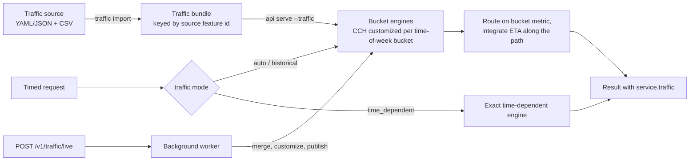

# Historical and live traffic

This guide shows how to route motor vehicles with time-of-week historical
speeds and with live speed or closure updates. Requests with a
`departure_time` use the traffic data. Requests without a time use the
free-flow speeds of the profile.



## Prerequisites

- An imported dataset.
- A profile of a motorized mode: car, taxi, motorcycle, moped, HGV or bus.
- A traffic source document, or `traffic synthesize` to make test data.

## Write a traffic source

A traffic source is a YAML or JSON document. Patterns are weekly speed
profiles. Assignments bind a pattern to a directed source feature. The
feature id is the OSM way id for OSM imports, and the mapped feature id
otherwise.

```yaml
traffic_id: groningen_synthetic
timezone: Europe/Amsterdam   # IANA zone of the time-of-week buckets
bucket_minutes: 15           # must divide 60, so clock changes fall on boundaries
patterns:
  - id: arterial_peak
    # One day of buckets (repeated Monday to Sunday) or a full week from
    # Monday 00:00. 0 means "no observation": the profile speed applies.
    speeds_kph: [50, 50, ...]
    weekend_speeds_kph: [50, 50, ...]   # optional, with a one-day profile
assignments:
  - {feature_id: 4463602, direction: both, pattern: arterial_peak}
assignments_csv: assignments.csv        # feature_id,direction,pattern_id
patterns_csv: patterns.csv              # pattern_id,speeds_kph (space separated)
```

| Field | Meaning |
| --- | --- |
| `traffic_id` | Id of the traffic set. `--name` on import replaces it |
| `timezone` | IANA time zone of the buckets |
| `bucket_minutes` | Bucket width in minutes. Must divide 60 |
| `patterns[]` | `{id, speeds_kph, weekend_speeds_kph?}` |
| `patterns_csv` | CSV with `pattern_id,speeds_kph`, relative to the document |
| `assignments[]` | `{feature_id, direction, pattern}` |
| `assignments_csv` | CSV with `feature_id,direction` and `pattern_id` or `speeds_kph`, relative to the document |

`direction` is `forward`, `backward` or `both`, relative to the source
geometry. An assignment CSV can have a `speeds_kph` column instead of
`pattern_id` for per-segment data. The bundle stores identical speed vectors
once.

!!! note
    Assignments and live updates use `feature_id`. There is no `way_id`
    alias.

## Import traffic

1. Import the source for a dataset:

    ```bash
    netweevil traffic import examples/traffic/groningen_synthetic.yml --dataset groningen
    ```

2. List the traffic sets:

    ```bash
    netweevil traffic list
    ```

The import reports how many directed features and edges of the dataset
match. It writes the bundle to
`.netweevil/bundles/traffic/traffic-<id>.bin` and a manifest under
`.netweevil/traffic/`. The bundle uses the sectioned format: patterns as
delta varints, feature ids as gaps. Its key is the source feature id. Thus it
binds to a re-imported or updated dataset at load time.

### Make synthetic test data

`examples/traffic/groningen_synthetic.yml` is synthetic test data, not
observations. It has road-class free-flow speeds with weekday morning and
evening dips, a milder weekend and four speed variants per class. This
command made it:

```bash
netweevil traffic synthesize --dataset groningen --name groningen_synthetic \
  --out examples/traffic/groningen_synthetic.yml
```

| Flag | Default | Meaning |
| --- | --- | --- |
| `--dataset`, `--name`, `--out` | required | Dataset, traffic set id and output document. Assignments go to `<stem>_assignments.csv` |
| `--timezone` | `Europe/Amsterdam` | IANA time zone of the patterns |
| `--bucket-minutes` | 15 | Bucket length |
| `--classes` | `motorway,trunk,primary,secondary` | Road classes that get patterns. Also `tertiary`, `residential`, `service` |
| `--variants` | 4 | Speed-scale variants per road class |

## Serve with traffic

1. Start the API with a traffic set:

    ```bash
    netweevil api serve --dataset groningen \
      --default-profile examples/profiles/car_north_nl_2026_05.yml \
      --traffic groningen_synthetic
    ```

2. Send a route with a `departure_time`, for example
   `examples/api/route_traffic.json`.

The API saves the selection in `.netweevil/workspace.json` (`traffic`). The
console activation request accepts a `traffic` field. Without `--traffic`,
live updates still work on top of the profile speeds.

## How speeds change costs

An observed speed `v` changes the profile time `t` of an edge:

| Profile mode | New time `t'` |
| --- | --- |
| Car, taxi, motorcycle | `length / v` |
| HGV, bus, moped | `max(t, length / v)`. These modes keep their own limits |
| Bicycle, foot | No change |

Ferries ignore traffic. The generalized cost changes by
`time_weight * (t' - t)`, with a floor at zero. This is the same rule that
the exact temporal engine uses for `SpeedFactor` schedules.

## Request field `traffic`

The `traffic` field, next to `departure_time`, selects the behavior:

| `traffic` | Behavior |
| --- | --- |
| `auto` (default) | Departure-bucket CCH with the live updates valid at departure |
| `historical` | Departure-bucket CCH. Ignores live updates |
| `time_dependent` | Exact time-dependent label-setting with traffic (routes only) |
| `off` | Ignores traffic |

Without loaded traffic data, all modes behave like `off`.

### Departure-bucket routing

The engine chooses the route on the CCH customized for the time-of-week
bucket of the departure, plus the live entries valid at that instant. The
route is exact for that metric. Equivalence tests compare it with the exact
engine on the same per-edge metric.

The engine then integrates the arrival time, the entry and exit times of each
segment, and the cost along the chosen path. It uses the speed in force at
each instant, across bucket boundaries and live expiries. The integration is
FIFO: a later entry to an edge never exits earlier.

Imported time rules (opening hours, closures) apply during the integration.
If the path is closed at a later entry time, the request falls back to the
exact time-dependent engine.

!!! note
    This is not full time-dependent optimality. A trip that crosses into a
    slower bucket can have a better alternative that the departure metric
    cannot see. The response reports `bucket_boundaries_crossed`. Zero means
    that the departure metric held for the full trip. With 15-minute buckets
    on a province network, peak ETAs differ from the bucket metric's own
    travel time by a few percent on average.

### Exact time-dependent routing

`traffic: time_dependent`, `arrive_by`, scenarios and overlays use the exact
label-setting engine. It integrates traffic speeds along each edge, including
live closures. A traveller can wait out a closure when the profile allows
waiting. Live expiries round up to whole minutes for that reason. The engine
is optimal for the full time-dependent cost, but slow: seconds to tens of
seconds per route on a province network.

Full time-dependent CCH variants (time-dependent CCH, CATCHUp) would close
that gap. They store piecewise-linear functions per arc. Per-bucket scalar
customizations use the existing hierarchy and exactness tests without
change.

### Batches

OD batches, matrices and service areas with a `departure_time` run on the
departure-bucket engine. Their costs and times come from the bucket metric.
The engine does not integrate them over the trip.

!!! warning
    Time-dependent batches with traffic are not supported. Set
    `traffic: off` to use the exact temporal engine without traffic.

### Combinations

| Combination | Result |
| --- | --- |
| Component constraints and Pareto routes | Error |
| Failure-mode fallbacks | Error |
| Engine modes other than `auto` | Error |
| Request-defined profiles | Traffic ignored |
| `/v1/directions` | Traffic ignored |
| Holiday calendar | Affects imported rules, not the speed buckets |

## Engines and caching

Each motorized profile keeps a least-recently-used cache of customized
engines. Set `NETWEEVIL_TRAFFIC_CACHE_ENTRIES` to an integer from 1 to 64 to
change the size. The default is 4.

- Buckets whose speed columns are identical across all patterns share one
  engine. The Groningen example has 30 distinct metrics in its 672 buckets.
- Concurrent requests for an uncached bucket wait for one customization.
- Engines that differ from the profile only in speeds share the adjacency,
  spatial index and hierarchy arrays of the profile engine. A live closure
  changes the adjacency and builds a full graph.

As a guide, on a province network, one bucket engine takes a few hundred
milliseconds to prepare. It uses about 200 MiB of memory. The first request
in a new bucket pays the customization. Later requests take a few
milliseconds.

## Live updates

=== "HTTP"

    ```bash
    curl -X POST 'http://127.0.0.1:8080/v1/traffic/live?wait=true' \
      -H 'content-type: application/json' \
      -d '{"updates": [
            {"feature_id": 4463602, "closed": true, "ttl_s": 1800},
            {"feature_id": 6348460, "direction": "forward", "speed_kph": 12, "expires_at": "2026-10-05T09:00:00+02:00"}
          ]}'
    curl -X DELETE 'http://127.0.0.1:8080/v1/traffic/live?wait=true'
    curl http://127.0.0.1:8080/v1/traffic
    ```

=== "CLI"

    `netweevil traffic route` runs one traffic-aware route. `--live` applies
    a JSON list of live updates before routing.

    ```bash
    netweevil traffic route --dataset groningen \
      --profile examples/profiles/car_north_nl_2026_05.yml \
      --traffic groningen_synthetic \
      --request examples/api/route_traffic.json \
      --departure-time 2026-10-05T17:30:00+02:00 \
      --mode time-dependent \
      --live updates.json
    ```

    `--live-at` sets the receipt time of the live updates (default: now).
    `--mode` replaces the `traffic` field of the request. `--out` writes the
    JSON result.

### Update fields

| Field | Default | Meaning |
| --- | --- | --- |
| `feature_id` | required | Source feature id |
| `direction` | `both` | `forward`, `backward` or `both` |
| `speed_kph` | none | Observed speed. Replaces the historical and profile speed |
| `closed` | `false` | The feature is impassable while the update is valid |
| `clear` | `false` | Removes the live state of the feature |
| `expires_at` | none | RFC 3339 expiry |
| `ttl_s` | 900 | Validity after receipt, when `expires_at` is absent |

Each update sets exactly one of `closed: true`, `speed_kph` or `clear: true`.
Validity starts at receipt. Set `"replace": true` on the batch to replace all
live entries. Otherwise, updates merge, and later updates win per directed
feature. The API rejects an invalid batch with HTTP 400 before it queues the
batch. `DELETE /v1/traffic/live` removes all live entries.

`examples/api/traffic_live_updates.json` slows one way and closes another.

### Publication

One background worker applies the batches:

1. It merges the queued batches.
2. It customizes the engine of each motorized profile for the current bucket
   with the new live state.
3. It publishes the new snapshot.

Requests that run during that time keep the previous snapshot and engines.
No request waits for the customization. Without `?wait=true`, the endpoint
answers `202 Accepted`. With `?wait=true`, it answers after publication.

The same worker prepares engines about 60 s before each bucket boundary and
live expiry. Thus the first request after the boundary finds a ready engine.
A workspace reload (`/v1/workspace/reload`, dataset updates) carries the live
state over to the new runtime.

## Result

Responses of traffic-aware analyses carry `service.traffic`. It reports:

- the engine and the departure bucket;
- the live version and the live entries applied;
- the cache hit or miss and the preparation time;
- the bucket boundaries crossed.

## Benchmark traffic

```bash
netweevil bench traffic --dataset groningen \
  --profile examples/profiles/car_north_nl_2026_05.yml \
  --traffic groningen_synthetic --corpus examples/perf/groningen_routes.csv --verify-exact
```

See [Benchmarking](benchmarking.md#benchmark-traffic) for the flags.

## Related pages

- [Routing](routing.md).
- [Multilayer and temporal routing](multilayer-temporal-routing.md) for
  scenarios and time rules.
- [Simulation](simulation.md) for agent-based congestion.
- [HTTP API reference](../api/reference.md) for the full schema.
