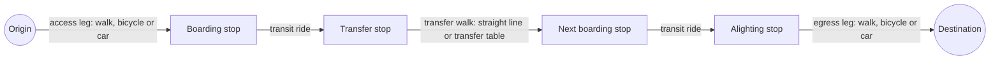

# Transit

This guide shows how to import a GTFS feed and plan door-to-door public
transport journeys. A journey has three parts:

1. an access leg from the origin to a stop;
2. one or more transit rides, with transfers between them;
3. an egress leg from the last stop to the destination.

The guide also covers transit service areas, stop
bindings, network transfer tables, service-day time rules and GTFS transfer
rules.



## Prerequisites

- A GTFS archive (zip) or a directory of GTFS text files. `agency.txt` must
  have a valid IANA `agency_timezone`.
- For network access, egress or transfers: an imported street dataset and a
  compiled foot profile. See [Datasets](datasets.md).

## Import a GTFS feed

1. Choose the first service date and the number of service days.
2. Run the import:

    ```bash
    cargo run -p netweevil-cli -- transit import \
      datasets/gtfs-openov-nl.zip \
      --name openov_nl_2026_05 \
      --service-start 2026-05-09 \
      --service-days 7
    ```

3. Check the feed with `netweevil transit list`.

| Flag | Default | Meaning |
| --- | --- | --- |
| `<SOURCE>` | required | GTFS zip archive or directory |
| `--name` | required | Id of the new feed |
| `--service-start` | required | First service date (`YYYY-MM-DD`) |
| `--service-days` | 7 | Number of service days to import |
| `--stop-bindings` | none | JSON or CSV stop binding table, applied before the bundle is written |

The import accepts a UTF-8 BOM and stop times after 24:00. It interpolates
blank intermediate stop times when the trip has timed endpoints.

!!! note
    Re-import feeds after an upgrade that changes the transit bundle schema.
    The reader rejects unsupported schemas. Re-importing a feed replaces its
    bundle and removes its registered transfer tables.

The console import endpoint is `POST /v1/workspace/transit/import` with
`{source, name, service_start, service_days}`. `source` is the name of a file
in `.netweevil/uploads/`. The endpoint starts a job.

## Plan a journey

=== "CLI"

    ```bash
    cargo run -p netweevil-cli -- analyze transit-route \
      --feed openov_nl_2026_05 \
      --request examples/requests/transit_openov_groningen.json \
      --out .netweevil/runs/example-transit-route.json
    ```

    `analyze transit-batch --requests <file>` runs a JSON file with a
    `requests` list of transit route requests.

=== "HTTP"

    1. Load the feed at startup:

        ```bash
        cargo run -p netweevil-cli -- api serve \
          --dataset groningen_2026_05 \
          --default-profile examples/profiles/car_research_v1.yml \
          --transit-feed openov_nl_2026_05 \
          --bind 127.0.0.1:8080
        ```

    2. Send `{feed_id, pedestrian_profile_id?, access_profile_id?,
       egress_profile_id?, request}` to `POST /v1/transit-route`.

`GET /v1/service` reports each loaded feed with its bound-stop count and its
available transfer profile ids.

### Request fields

| Field | Default | Meaning |
| --- | --- | --- |
| `route_id` | required | Identifier of the result |
| `origin`, `destination` | required | `{id, lon, lat, z?}` |
| `time.datetime` | required | Departure time, or arrival deadline with `arrive_by` |
| `time.arrive_by` | `false` | Plans backward from a deadline |
| `time.search_window_s` | 3600 | Length of the search window |
| `modes` | defaults | See [Mode options](#mode-options) |
| `returns.include_geometry` | `false` | Includes leg geometry |
| `returns.walking_geometry` | `straight_line` | `straight_line` or `network` |
| `returns.include_stops` | `false` | Includes stops |
| `returns.include_stop_segments` | `false` | Includes the segments between stops |
| `alternatives.max_routes` | 1 | Number of journeys |
| `alternatives.max_time_ratio` | 1.5 | Largest travel time relative to the best journey |
| `alternatives.max_extra_time_s` | none | Largest extra travel time |

The API envelope selects profiles explicitly with `pedestrian_profile_id`,
`access_profile_id` and `egress_profile_id`. The pedestrian profile must use
the `foot` mode. Without it, the API uses the first loaded foot profile.

### Mode options

| Field | Default | Meaning |
| --- | --- | --- |
| `access`, `egress` | `["walk"]` | `walk`, `bicycle` or `car` |
| `mixed_access_egress` | `false` | Allows different access and egress lists |
| `transit` | all except `air` and `other` | `tram`, `subway`, `rail`, `bus`, `ferry`, `cable_car`, `gondola`, `funicular`, `coach`, `air`, `other` |
| `walk_speed_kph` | 4.8 | Walking speed |
| `bicycle_speed_kph` | 15 | Cycling speed |
| `car_access_speed_kph` | 25 | Car speed |
| `max_access_distance_m`, `max_egress_distance_m` | 1,000 | Walking limits |
| `max_bicycle_access_distance_m`, `max_bicycle_egress_distance_m` | 5,000 | Cycling limits |
| `max_car_access_distance_m`, `max_car_egress_distance_m` | 15,000 | Car limits |
| `max_endpoint_snap_distance_m` | 50 | Largest horizontal gap from an endpoint to its street attachment |
| `max_transfer_distance_m` | 500 | Radius of straight-line transfers |
| `transfer_profile_id` | none | Selects a network transfer table |
| `board_slack_s` | 30 | Time to board |
| `transfer_slack_s` | 120 | Extra time at each transfer |
| `max_transfers` | 4 | Largest number of transfers |
| `min_transit_leg_duration_s` | 0 | Shortest transit ride |
| `min_transit_leg_distance_m` | 0 | Shortest transit ride distance |
| `street_access` | `straight_line` | `straight_line` or `network` |

`max_endpoint_snap_distance_m` is independent of the radius that finds
candidate stops. A larger access distance does not permit a distant street
attachment.

## Access and egress legs

The first and last miles can use `walk`, `bicycle` or `car`. Each mode has
its own speed and distance limits.

By default, the access and egress mode lists must match. To plan an
asymmetric journey, set `modes.mixed_access_egress: true`. An example is to
cycle to the station and walk from the final stop. See
`examples/requests/transit_bike_access_groningen.json`.

### Straight-line and network legs

With `street_access: "straight_line"` (default), the engine prices access and
egress legs as straight-line distance over the mode speed.

With `street_access: "network"`, the engine uses street-network paths:

- The API resolves a loaded street profile for each access mode. Walking
  needs a foot profile.
- Each candidate stop must receive a routed network path. A missing engine, a
  disconnected pair, an inaccessible paid area or a missing profile removes
  that candidate.
- If no candidate remains, the journey is unreachable.

!!! warning
    Network mode never substitutes straight-line time. Select
    `street_access: "straight_line"` when you want geometric legs.

On the CLI, pass both `--street-dataset` and `--street-profile` when any
request selects network access:

```bash
netweevil analyze transit-route \
  --feed hk_example_mtr \
  --request path/to/network-access-request.json \
  --street-dataset hk_pedestrian_3d \
  --street-profile examples/profiles/pedestrian_multilayer.yml

netweevil analyze transit-batch \
  --feed hk_example_mtr \
  --requests path/to/network-access-batch.json \
  --street-dataset hk_pedestrian_3d \
  --street-profile examples/profiles/pedestrian_multilayer.yml
```

!!! note
    The CLI network estimator uses a foot profile. It accepts walk-only
    `modes.access` and `modes.egress`. Bicycle or car network legs on the CLI
    fail with an error. They are not priced as walking. Requests with
    `straight_line` do not need the street flags.

An endpoint can carry `z`. Network access and egress then use a one-metre
height window around that height.

## Depart-after and arrive-by searches

Transit routes and transit service areas plan in both directions:

- With `time.arrive_by: false`, the scan finds the earliest arrival after
  `time.datetime`. `search_window_s` limits how long after that time a trip
  can depart.
- With `time.arrive_by: true`, the scan finds the latest departure that
  reaches the destination by `time.datetime`. `search_window_s` limits how
  long before that deadline a trip can arrive.

The arrive-by scan is the mirror of the depart-after scan. It reads the same
connection arrays. Board slack, transfer slack, `max_transfers`, mode filters,
minimum leg constraints, access and egress pricing, stop bindings and
transfer tables all apply in the same way. Transfer tables are directed. The
reverse scan uses the transfers that end at a stop. Thus a passage priced
only from A to B is never used from B to A.

An arrive-by route returns legs in forward order with scheduled timestamps:

- `summary.departure_s` is the latest possible departure.
- `summary.arrival_s` is the arrival at or before the deadline.
- The access leg ends at the first boarding.
- Each transfer walk starts one transfer slack after the previous alighting.

Journeys that cannot meet the deadline are `unreachable`. The QGIS transit
and service-area tabs show the same option as an **Arrive by** checkbox.

Each dated or frequency departure has its own `run_index`. Transit legs
return it with the public trip id. Thus two vehicles that use the same GTFS
trip are not treated as one vehicle. Pickup and drop-off are allowed only at
regular scheduled stops. GTFS types `1`, `2` and `3` are excluded. The engine
does not model service arranged by phone or with the driver.

Straight-line transfers include each stop within `max_transfer_distance_m`.
The prepared router caches that adjacency for the active radius.

## Time zones and service days

GTFS imports require `agency.txt` with a valid IANA `agency_timezone`. All
agencies in a feed must have the same time zone. Stop time zones do not
change how the engine reads `stop_times.txt`.

The engine converts the timetable of each service day to real instants with
the GTFS rule:

1. Find local noon in the agency time zone.
2. Subtract twelve elapsed hours.
3. Add the GTFS stop time.

Around a daylight-saving change, two service-day origins can be 23 or 25
hours apart. Times above `24:00:00` stay attached to their service day. They
can run past the last imported calendar date.

For example, an Amsterdam trip on 24 October 2026 has stop times `26:15:00`
and `27:15:00`. It departs at `2026-10-25T02:15:00+02:00` and arrives at
`2026-10-25T02:15:00+01:00`. Its travel time is one hour, although the local
clock readings are the same.

### Request times

- Use RFC 3339 datetimes with an explicit UTC offset when possible.
  `2026-03-29T07:59:00+02:00` and `2026-03-29T05:59:00Z` are the same
  instant.
- A datetime without an offset is read in the agency time zone.
- The engine rejects an ambiguous time during an autumn clock change. Supply
  an offset.
- The engine rejects a local time that a spring clock change skips.
- Datetimes have whole-second precision.

These rules apply to depart-after, arrive-by and service-area queries.
Overnight queries can refer to the day after the imported service window.
The engine rejects a query before the time origin of the timetable. To search
earlier, import an earlier service day.

### Returned times

Route and service-area results include `time_context`:

```json
{
  "agency_timezone": "Europe/Amsterdam",
  "time_origin_unix_s": 1792792800
}
```

Each `departure_s` and `arrival_s` is an elapsed UTC-second offset from
`time_origin_unix_s`:

```text
unix_timestamp = time_origin_unix_s + departure_s
```

Durations such as `travel_time_s` are elapsed seconds.

!!! warning
    Do not divide returned times by 86,400 to find a service date. Do not use
    the remainder as a local clock time.

Rust callers can use `TransitTimeContext::datetime(seconds)` to get an
agency-local RFC 3339 datetime with the correct offset.

The origin is the earlier of two instants: local midnight of the first
service day, and its GTFS noon-minus-twelve-hours anchor. This also covers
midnight queries on an autumn transition day whose GTFS anchor is after
midnight. API service metadata and feed manifests show the same time zone and
origin. Exported QGIS and GeoJSON features keep both fields.

The web console shows GTFS departures and arrivals as dates and clock times
in the feed time zone, with the UTC offset at daylight-saving changes.

The time rules follow the
[GTFS schedule reference](https://gtfs.org/documentation/schedule/reference/#field-types)
and the [agency time zone requirement](https://gtfs.org/documentation/schedule/reference/#agencytxt).
Time zone conversion uses the IANA data in
[chrono-tz](https://docs.rs/chrono-tz/latest/chrono_tz/).

The bundle stores each repeated run pattern once, as stops and relative
times. It stores each vehicle run as a pattern and a start time. Loading
restores the exact connection order. A feed with 16 million connections takes
about 16 MB.

## GTFS transfer rules

The import reads `transfers.txt`. Depart-at, arrive-by and service-area
searches apply the rules when the traveller changes vehicles:

| `transfer_type` | Behavior |
| --- | --- |
| 0 | Recommended connection. Normal walking and boarding feasibility apply |
| 1 | Timed connection. The engine uses scheduled times. It does not simulate a vehicle that waits for another vehicle |
| 2 | Requires `min_transfer_time` between arrival and departure |
| 3 | Connection prohibited |
| 4, 5 | Rejected during import |

For type 1, the import output and each query result on the feed include this
limitation in the diagnostics.

A supplied minimum time applies to the full interchange, including the walk.
Request walking limits, boarding slack and transfer slack must also be
satisfied. A larger minimum replaces the smaller threshold. The engine does
not add it a second time to the walking time. Rules do not create a street
path when a network transfer table has none.

Rules can select stops, routes or trips. A station selector applies to all
its child stops. The strongest matching rule wins. The order follows the six
levels in the GTFS reference:

1. two trips;
2. one trip and the opposite route;
3. one trip;
4. two routes;
5. one route;
6. stops alone.

A trip selector takes precedence over its own route selector. When you supply
both, the engine validates the route membership of the trip.

- The import rejects duplicate normalized scopes.
- If two different rules of equal highest specificity match a trip pair, the
  query returns an error. It does not choose by input order. Add a more
  specific rule to resolve the conflict.
- The import omits trip-specific rules for services outside the imported
  window.

The router keeps the incoming and outgoing vehicle connection across a
transfer walk. Thus a faster forbidden interchange cannot discard a slower
legal one. Consecutive walking hops cannot erase the rule context. To stay on
the next connection of the same vehicle run is not a transfer. A prohibition
does not block it.

!!! note
    Cross-trip in-seat continuity, coupling and vehicle holding are not
    supported. Ordinary continuation within one GTFS trip is supported. The
    type 1 interpretation is a known limitation. See the
    [GTFS transfers reference](https://gtfs.org/documentation/schedule/reference/#transferstxt).

## Stop bindings

By default, a GTFS stop uses its own longitude and latitude. A stop binding
attaches a stop to an exact place in a street or indoor graph instead. The
place can be:

- a node;
- an edge with a fraction;
- a coordinate with a height and an attribute filter.

Use bindings for station platforms on different floors.

### Binding table format

A binding table belongs to one feed. When you apply it, it replaces all
bindings of the feed.

```json
{
  "schema_version": 1,
  "feed_id": "hk_example_mtr",
  "bindings": [
    {"stop_id": "ILLUSTRATIVE-PLATFORM-A", "node": {"node_id": 18432}},
    {"stop_id": "ILLUSTRATIVE-PLATFORM-B", "edge": {"edge_id": 9012, "fraction": 0.35}},
    {
      "stop_id": "ILLUSTRATIVE-PLATFORM-C",
      "coordinate": {
        "lon": 114.1577,
        "lat": 22.2820,
        "z": -8.2,
        "z_window_m": 1.5,
        "attribute_filter": {"indoor_location": "platform"}
      }
    }
  ]
}
```

!!! warning
    These ids and coordinates are illustrative. They are not built-in station
    data. Replace them with values from the imported feed and the prepared
    network. The full file is
    `examples/transit/hong_kong_example_stop_bindings.json`.

A CSV binding table has the columns
`stop_id,kind,node_id,edge_id,fraction,lon,lat,z,z_window_m,attribute_filter`.
The `attribute_filter` cell holds a JSON object. You can omit `kind` when the
populated target columns are unambiguous. See
`examples/transit/stop_bindings.csv`.

### Apply bindings

1. Apply the table during import with `--stop-bindings`, or later:

    ```bash
    netweevil transit bindings apply --feed hk_example_mtr \
      examples/transit/hong_kong_example_stop_bindings.json
    ```

2. Rebuild the transfer tables of the feed. See
   [Network transfer tables](#network-transfer-tables).

The engine validates and applies a table atomically.

!!! warning
    Applying bindings removes the registered transfer tables of the feed.
    Tables built against old platform locations must be rebuilt.

A bound stop whose network path is unreachable does not fall back to its GTFS
coordinate. A fallback would bypass the platform or node constraint.

### Audit bindings

Inspect each bound stop against the loaded graph:

```bash
curl --fail-with-body \
  'http://127.0.0.1:8080/v1/transit-feeds/hong_kong_multimodal/bindings?pedestrian_profile_id=pedestrian_fastest_multilayer'
```

The audit shows source coordinates, resolved graph coordinates, candidate
components and failures. It does not replace an unresolved platform with a
street stop.

## Network transfer tables

Without a transfer table, transfers use straight-line walking. A transfer
table holds directed stop-to-stop paths through a street or indoor graph for
one foot profile. Build separate tables for profiles such as `walk` and
`step_free`.

1. Compile the foot profile for the street dataset.
2. Build the table:

    ```bash
    netweevil transit transfers build \
      --feed hk_example_mtr \
      --dataset hk_pedestrian_3d \
      --profile examples/profiles/pedestrian_step_free_multilayer.yml \
      --max-transfer-distance-m 500 \
      --max-candidates-per-stop 32
    ```

3. Select the table in a request:

    ```json
    {
      "feed_id": "hk_example_mtr",
      "request": {
        "modes": {
          "street_access": "network",
          "transfer_profile_id": "pedestrian_step_free_multilayer",
          "max_transfer_distance_m": 500
        }
      }
    }
    ```

| Flag | Default | Meaning |
| --- | --- | --- |
| `--feed` | required | Feed id |
| `--dataset` | required | Street or indoor dataset with the bound stops |
| `--profile` | required | Compiled foot profile for the transfers |
| `--max-transfer-distance-m` | 500 | Largest straight-line distance between stops |
| `--max-candidates-per-stop` | 32 | Largest number of nearest stops routed from each stop |
| `--out` | none | Output path. `.json` writes readable JSON. Other extensions use the packed binary layout |

The command routes each nearby directed stop pair. It registers the table on
the feed and records the dataset and profile document. The API loads the
tables registered for its active dataset. For API requests, put
`transfer_profile_id` in `request.modes`.

`street_access: "network"` controls access and egress separately from
`transfer_profile_id`.

### Transfer table behavior

- The table omits unreachable pairs. An unavailable lift or inaccessible
  platform does not get a geometric fallback.
- When a request selects a profile, the search uses only that table for
  stop-to-stop transfers. It does not fall back to straight-line walking for
  missing entries.
- A precomputed table uses its build-time candidate limit, not the request
  radius.
- An access, transfer or egress leg can include `network_path`. It has
  `travel_time_s`, the network distance, a 3D geometry, routed edge ids and
  named cost components. This shows the actual station corridor, escalator,
  stairs or lift path.

The packed layout keeps the routing columns (target stop, straight-line
distance, walking time) as flat arrays. It stores paths once per origin stop
as a trie of shared edge and geometry steps. Coordinates are in a
deduplicated point pool. Unpacking is lossless. The engine decodes only the
paths of returned legs. A packed pedestrian table for a city-size network is
tens of megabytes.

!!! note
    The reader rejects tables in older layouts. Rebuild them with
    `netweevil transit transfers build`.

Rust hosts can use `build_packed_transit_transfer_table`,
`read_packed_transit_transfer_table` and
`PreparedTransitRouter::new_with_packed_transfer_tables` to keep the table
packed. `build_transit_transfer_table`, `read_transit_transfer_table` and
`new_with_transfer_tables` work with the expanded `TransitTransferTable`.
`TransitTransferBuildOptions` holds the walking profile id, the distance
radius and the candidate cap.

A host that routes access and egress legs implements `StreetTimeEstimator`.
It receives the full `TransitStop`, including its binding, through
`point_to_stop_path`, `stop_to_point_path` and `stop_to_stop_path`. In
network mode, a `None` path makes that stop unreachable.

## Transit service areas

A transit service area shows what a traveller reaches with transit within a
time budget. Send `{feed_id, pedestrian_profile_id?, access_profile_id?,
egress_profile_id?, request}` to `POST /v1/transit-service-area`. Add
`?format=geojson` for GeoJSON.

| Field | Default | Meaning |
| --- | --- | --- |
| `analysis_id` | required | Identifier of the result |
| `origins[]` | `[]` | `{id, lon, lat, z?}` |
| `time` | required | As for a transit route |
| `modes` | defaults | As for a transit route |
| `catchment_mode` | `stops` | `stops` or `street_isochrone` |
| `max_travel_time_s` | 3600 | Time budget |
| `returns.include_stops` | `true` | Includes reachable stops |
| `returns.include_stop_segments` | `true` | Includes ridden segments |
| `returns.include_geometry` | `true` | Includes geometry |
| `returns.max_stops` | 100,000 | Upper limit of stops |
| `returns.max_stop_segments` | 200,000 | Upper limit of segments |
| `returns.max_geometry_points` | 1,000,000 | Upper limit of geometry points |

Transit service areas accept the same `modes` block as routes. Thus
cycling-and-transit or car-and-transit catchments work. See
`examples/requests/transit_service_area_car_access.json`.

### Street isochrone catchments

`catchment_mode: "street_isochrone"` continues on the street network after
transit:

- It uses network access.
- It continues from each stop where alighting is allowed. It spends the
  remaining `max_travel_time_s` on the egress street network.
- It includes direct street travel from the origin.
- The time budget includes access, waiting, rides, transfers and egress.
- The final street expansion has a time limit, not the stop-access distance
  limit.
- Arrive-by catchments expand backward along incoming streets to stops from
  which transit reaches the target by the deadline.

Load a foot profile and a street profile for each bicycle or car mode.
Street speeds, access restrictions and turn rules come from those profiles.
The result `features` contain the reachable network with edges cut at the
time limit, and polygons around it. Street costs use the loaded static
profile. The polygon boundary is an approximation. You can return or disable
stops and transit segments independently. See
`examples/requests/transit_service_area_isochrone.json`.

In the web console, select **Street isochrone** in the Transit reach tool.
In QGIS, select it in the transit service-area options.

### Arrive-by service areas

An arrive-by service area reports, for each stop, the latest clock time at
which a traveller can be there, in `arrival_s`. `travel_time_s` counts back
from the deadline. Ridden segments carry the time from their departure to the
deadline.

## Transit directions

`POST /v1/transit-directions` accepts the same payload as
`/v1/transit-route`. It also accepts `directions_options`. See
[Routing](routing.md#turn-by-turn-directions).

The JSON response contains `service`, the full route `result` and ordered
`directions`:

- Instructions cover access, waiting, boarding, riding, alighting, station
  transfers and egress.
- Each instruction has a leg index, a duration and timestamps in the feed
  time zone.
- Station names, platform codes, headsigns and XYZ locations accompany the
  text when available.
- `walking_maneuvers` holds street turns and source stair, escalator or lift
  instructions. Turns appear only when the instruction engine reproduces the
  saved walking path. `directions_diagnostics` explains an omission.
- An unreachable journey has an empty `directions` array.

This endpoint always includes geometry, stops and intermediate stop segments.
It returns JSON only.

## Station geometry

`POST /v1/transit-feeds/{feed_id}/station-geometry` returns platform polygons
and bound boarding points inside a WGS84 `bbox`. It keeps the source XYZ. The
GeoJSON response includes coverage and truncation metadata. `limit` defaults
to 2,000.

The server derives the optional surface sidecar file from the imported GTFS
file name. For example, `hong_kong_multimodal.gtfs.zip` uses
`hong_kong_multimodal.gtfs.stations.geojson` next to it. Boarding points come
from the graph bindings of the loaded feed. The endpoint accepts no
client-supplied file path.

## Vehicle geometry heights

Vehicle legs use GTFS shapes where present. Their Z is interpolated between
bound platform stops for display. The leg marks it with
`geometry_elevation_source`. With stop segments, the main geometry passes
through each returned intermediate platform height. Without them, the
interpolation uses the leg endpoints.

!!! note
    These heights are not surveyed rail tunnel geometry. Walking paths use
    the actual 3D network. Unknown source elevations stay marked as unknown.
    A display height of zero is not a measurement.

## GTFS editor

The web console has a GTFS editor. Use it to draw new lines on the map, copy
routes as express variants, and give them a timetable: days, headway windows
and extra departures. A scenario builds into a separate feed, either on top
of an imported feed or from scratch. The imported feed and its zip do not
change. "Revert" removes the built feed.

| Endpoint | Purpose |
| --- | --- |
| `GET|POST /v1/gtfs-editor/scenarios` | List or create scenario documents |
| `GET|PUT|DELETE /v1/gtfs-editor/scenarios/{id}` | Read, replace or delete a scenario |
| `POST /v1/gtfs-editor/scenarios/{id}/build` | Job that expands the timetable, merges it on the base feed (or builds a stand-alone feed), writes a new feed and loads it |
| `POST /v1/gtfs-editor/scenarios/{id}/revert` | Unloads and deletes the built feed. Keeps the scenario and the base feed |
| `GET /v1/gtfs-editor/scenarios/{id}/export` | The scenario as a GTFS zip, also written next to the document |
| `GET /v1/transit-feeds/{feed}/stops?bbox=&q=` | Stops of a loaded feed |
| `GET /v1/transit-feeds/{feed}/routes?q=` | Routes of a loaded feed |
| `GET /v1/transit-feeds/{feed}/patterns?route_id=` | Stop patterns of a route |

Scenario documents are JSON files in `.netweevil/gtfs_scenarios/<id>.json`.
Exported archives are `<id>.gtfs.zip` in the same folder.

## Related pages

- [Multilayer and temporal routing](multilayer-temporal-routing.md) for 3D
  pedestrian networks.
- [Hong Kong tutorial](hong-kong-tutorial.md) for a full transit example.
- [Service areas](service-areas.md) for street service areas.
- [HTTP API reference](../api/reference.md) for the full schema.
