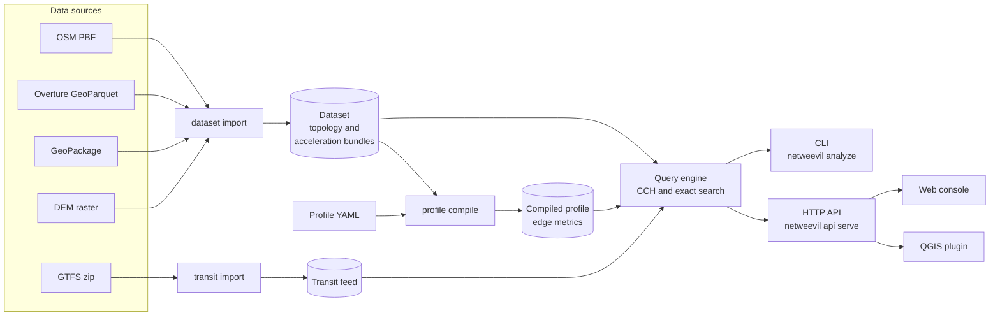

# NetWeevil

NetWeevil is a local network analysis system. It imports street networks
from OpenStreetMap, Overture Maps and GeoPackage files. It calculates routes
and network analyses on your computer. It does not send data to an external
service.

NetWeevil has three user surfaces:

- The `netweevil` command-line interface (CLI).
- An HTTP API. The API also serves the web console.
- A QGIS plugin. The plugin sends requests to the API and loads the results
  into a QGIS project.

The engine is deterministic. The same dataset source extract and the same
profile document give the same result.

## Capabilities

-   :material-map-marker-path: **Street routing**

    ---

    Routes, turn-by-turn directions, via points, alternatives, trip
    optimization and trace matching.

    [:octicons-arrow-right-24: Routing](guides/routing.md)

-   :material-grid: **Batch analysis**

    ---

    Origin-destination pairs, travel time matrices, accessibility counts,
    betweenness and scenario comparison.

    [:octicons-arrow-right-24: Batch analysis](guides/batch-analysis.md)

-   :material-vector-polygon: **Service areas**

    ---

    Outbound and inbound reach within a time or distance limit, as network
    edges and polygons.

    [:octicons-arrow-right-24: Service areas](guides/service-areas.md)

-   :material-tune: **Profiles**

    ---

    YAML profiles for car, bicycle, foot, bus, HGV, taxi, motorcycle and
    moped. Each profile sets speeds, exclusions, turn costs and preferences.

    [:octicons-arrow-right-24: Profiles](concepts/profiles.md)

-   :material-bus-clock: **Transit**

    ---

    GTFS import, transit journeys with walk, bicycle or car access, transit
    service areas and a GTFS scenario editor.

    [:octicons-arrow-right-24: Transit](guides/transit.md)

-   :material-car-multiple: **Traffic and simulation**

    ---

    Historical and live traffic speeds, and agent-based traffic simulation
    with congestion output.

    [:octicons-arrow-right-24: Simulation](guides/simulation.md)

-   :material-layers-triple: **3D and temporal networks**

    ---

    Multilayer pedestrian networks, elevation, opening hours and
    time-dependent routing.

    [:octicons-arrow-right-24: Multilayer routing](guides/multilayer-temporal-routing.md)

-   :material-monitor-dashboard: **Web console and QGIS**

    ---

    A browser console for setup and exploration, and a QGIS plugin for
    spatial workflows.

    [:octicons-arrow-right-24: Web console](tools/web-console.md)

## Overview

The diagram shows how data moves through NetWeevil.

1. `netweevil dataset import` reads a source extract and writes a dataset.
2. `netweevil profile compile` applies a profile to a dataset. The result is
   a compiled profile.
3. `netweevil transit import` reads a GTFS zip and writes a transit feed.
4. The query engine loads the dataset and the compiled profiles. It can
   also load transit feeds.
5. The CLI and the API send requests to the query engine.
6. The web console and the QGIS plugin use the API.

## Where to start

| Task | Page |
| ---- | ---- |
| Install NetWeevil | [Installation](getting-started/installation.md) |
| Calculate a first route | [Quickstart](getting-started/quickstart.md) |
| Run NetWeevil in a container | [Docker](getting-started/docker.md) |
| Learn the crate structure | [Architecture](concepts/architecture.md) |
| Find the files that NetWeevil writes | [State directory](concepts/state-layout.md) |
| Write a profile | [Profiles](concepts/profiles.md) |
| Look up a command | [CLI reference](cli/reference.md) |
| Look up an API operation | [HTTP API](api/index.md) |
