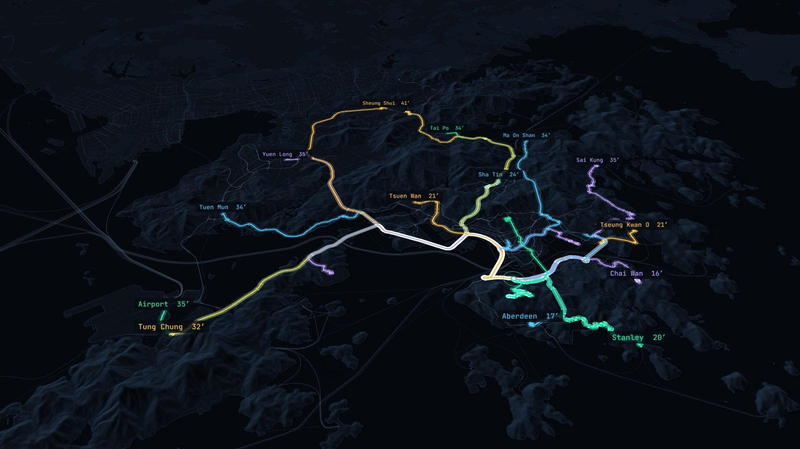
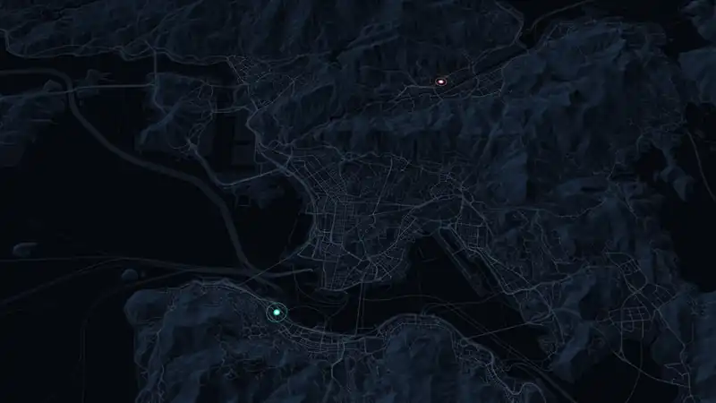
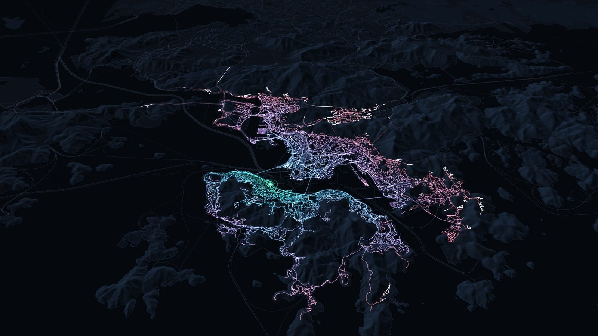
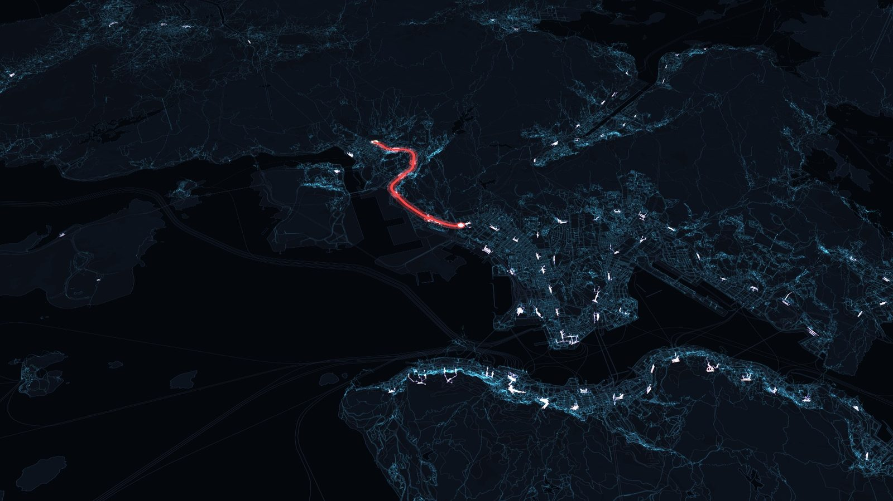
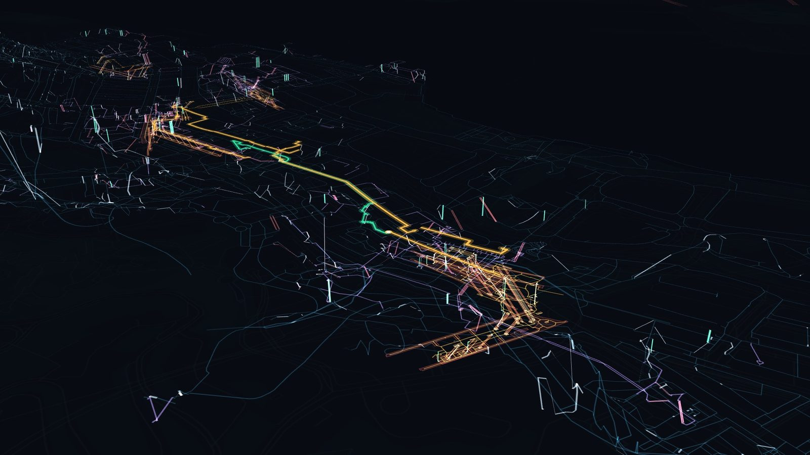

# Web console

The web console is a map application for the NetWeevil HTTP API. It sends
requests to every API endpoint and shows the results on a map. It also gives a
setup flow for a new workspace.

The `netweevil` executable serves the console at `/`. The API and the console
use the same address, for example `http://127.0.0.1:8080/`.



The console uses Vite, React 19, TanStack Query and MapLibre GL. The basemaps
(OpenFreeMap Positron, CARTO dark and OpenStreetMap) need no access key.

## Start the console

Use one of these procedures. Each procedure starts the API and the console in
setup mode when no dataset is loaded.

### Use the start script

The start script builds the console and the executable at the first start. You
need Rust and Node.js for this build only.

1. Go to the repository root.
2. Run the start script:

    ```bash
    ./scripts/start.sh              # macOS and Linux
    scripts\start.cmd               # Windows
    ```

3. Wait for the browser to open.

The script keeps the workspace in `~/NetWeevil`. Set
`NETWEEVIL_WORKSPACE=/some/folder` to use a different folder.

### Use a prebuilt archive

1. Extract the archive.
2. Run `start-netweevil.sh` (macOS and Linux).

The workspace is `~/NetWeevil`. Maintainers make the archive with
`scripts/package_release.sh`.

### Use Docker

1. Run `docker compose up -d api`.
2. Open `http://localhost:8080/`.

The image contains the console. Files in `./datasets` are available in the
container as `/data/datasets/<file>`. Use these paths for large extracts
instead of an upload. The [Docker guide](../getting-started/docker.md) gives
more information.

### Use the executable

1. Build the console. This writes `frontend/dist`.

    ```bash
    pnpm --dir frontend install
    pnpm --dir frontend build
    ```

2. Build the executable. The build embeds `frontend/dist` when it exists.

    ```bash
    cargo build --release -p netweevil-cli
    ```

3. Go to the folder that holds the workspace.
4. Start NetWeevil with one of these commands:

    ```bash
    netweevil bootstrap             # opens the browser
    netweevil bootstrap --no-open   # does not open the browser
    netweevil api serve             # no banner, no browser
    ```

`bootstrap` prints the folders that NetWeevil writes to. An executable without
an embedded console finds `frontend/dist` when you run it in the repository.
You can also give the folder with `--console-dir <path>`.

### Connect to an API with a dataset

1. Start the API with a dataset and profiles:

    ```bash
    netweevil api serve \
      --dataset groningen_2026_05 \
      --default-profile examples/profiles/car_research_v1.yml \
      --profile examples/profiles/pedestrian_research_v1.yml
    ```

2. Open `http://127.0.0.1:8080/`.

## Set up a workspace

The **Setup** panel is at the bottom left of the rail. It opens automatically
when the API has no dataset. All files that Setup makes are in the
`.netweevil/` state directory of the workspace. NetWeevil does not change
source files.

1. Read **Where things live**. It lists each folder under `.netweevil/` and its
   purpose. Uploads go to `.netweevil/uploads/`. NetWeevil reads files that you
   select by path in their location.
2. In **Street network**, upload an OSM `.osm.pbf` or Overture `.parquet`
   extract, or type a path on the machine.
3. Start the import. The import runs as a background job and shows its
   progress.
4. In **Routing profiles**, make car, bicycle and pedestrian profiles from the
   built-in templates.
5. Optional: edit the YAML of a profile.
6. Save the profiles. Setup writes them to `.netweevil/profiles/`.
7. Optional: in **Transit**, import GTFS zip files.
8. In **Load and go**, select the dataset, the profiles and the feeds.
9. Load the selection. The API compiles each profile at its first load.

Setup saves the selection to `.netweevil/workspace.json`. The next
`netweevil bootstrap` or `netweevil api serve` without arguments loads it
again.

The [state layout](../concepts/state-layout.md) page describes each folder.

## Run an analysis

1. Select an analysis in the left rail.
2. Click the map to put point A.
3. Click the map again to put point B.
4. Read the result on the map and in the results panel.

Route tools (route, directions, waypoints, OD pairs, transit route and
scenario batch) share one list of start and end pairs. The pairs stay when you
change the tool.

- Drag a marker to move it.
- Right-click a marker to remove it.
- Click **+ Add** to add a route. Each route has its own colour.
- Use **Scatter routes in view** to add a number of random routes for a load
  test.
- Use **Paste** to add JSON pairs or `lon,lat,lon,lat` lines.
- In the waypoints tool, each click after A and B adds a via stop.

Other tools show their own point slots. Click the map to add a point to the
highlighted slot. Tools share slots. For example, matrix origins and
accessibility origins are the same points.

**Live** is on by default for route tools. The console sends the request again
when an input changes, and cancels older requests. **Run** (or Enter) also
zooms to the result.

### Common controls

- The header search box takes a place name or a `lon, lat` pair. Place search
  uses OpenStreetMap Nominatim in the dataset extent.
- **Compare with** under the profile selector runs the same routes with more
  profiles. Each profile has its own colour and a row in the results table.
- Form fields are in groups: snapping, connectivity, fallback, returns,
  alternatives, time and request-defined profiles.
- **Request** shows the request JSON. An edit of this JSON overrides the form
  until you reset it.
- **Copy curl** copies a shell command for the same request.
- Endpoints that support `?format=geojson` let you select JSON or GeoJSON for
  each run.
- The "–" button next to the tool title hides the settings. The "‹" tab on
  the map edge hides the panel.

### Results

The results panel has these tabs:

| Tab | Contents |
|---|---|
| Directions | Turn-by-turn steps of the directions tool. Click a step to go to it. |
| Summary | Key values. With more than one route, a table with one row for each route. |
| Table | Each row set of the result. You can sort the rows and export CSV. |
| JSON | The full result. |

You can export the result JSON, the map GeoJSON, the server GeoJSON and the
request body.

The map corner has these buttons:

- **Style**: colours, opacity, outline and line widths. A legend lists the
  bands.
- **Clear map**: removes the results and keeps the points.
- **Clear all**: removes points, routes and results (Ctrl+Shift+Backspace).

### Keyboard

| Key | Action |
|---|---|
| Enter | Run the request |
| Escape | Cancel the request |
| Delete | Remove the last point of the active route |

### Performance readout

The readout in the bottom-right corner shows the status, time, size and
feature count of the last request. Expand it to see:

- first-byte, download and parse times,
- minimum, p50, mean, p95 and maximum time for each endpoint,
- a request log,
- a benchmark that repeats the last request N times at concurrency C,
- CSV and JSON export of all times.



## Street tools

### Network explorer

The network explorer colours the edges in the map view. Select one of these
sources:

- a source attribute: road class, surface, speed limit, gradient, access or
  one-way,
- a value of the selected profile: speed, travel time, cost per km or access.

Select a second profile to colour the difference: speed change, time ratio, or
access by one or both profiles. Hover an edge to see all values. When you zoom
in, the explorer runs again as the map moves.

### Trip

The trip tool puts map stops in the best visit order with `POST /v1/trip`.

1. Click the map to add stops. The console gives each stop a letter.
2. Optional: give a stop a service time and a time window (HH:MM on the trip
   clock).
3. Select a mode: round trip, fixed start, fixed end, or open trip.
4. Run the request.

The map numbers the stops in visit order. The Summary lists arrivals, waits,
lateness, and the method, proof and costs of the optimizer.

### Live traffic

1. Click roads on the map. The console finds the nearest OSM way of each click
   with `/v1/locate`.
2. Select close, slow or clear.
3. Click **Post live updates**. The console sends
   `POST /v1/traffic/live?wait=true`.

The panel shows `GET /v1/traffic`: the historical set, the current bucket and
the live entries. Route, OD, matrix and service-area tools show a traffic
status line. The **Traffic** option under Time has the values auto,
historical, exact time-dependent (routes only) and off. It applies to requests
with a departure time.

### Heights

The heights tool reads the DEM of the dataset with `POST /v1/height`. It
samples clicked points, or the line through them as a profile chart. The
Returns options of the route tool add **Regions** (country and state spans,
border crossings, timezones) and an **Elevation profile**.



## Transit tools

### Transit route, directions and reach

Transit route and transit reach use **Allowed transit modes** checkboxes.

- A checked mode is permitted.
- **Allow all** and **Allow none** change all modes.
- An empty selection excludes all transit vehicle modes.
- New forms use the nine default modes of the API. Air and Other start
  unchecked.

**Transit directions** sends the same inputs to
`POST /v1/transit-directions`. The Summary shows walk, board, ride, alight and
transfer instructions with platforms and times in the feed timezone. Expand
**Walking instructions** to see street and facility steps. This endpoint gives
JSON only. The other transit tools also give server GeoJSON.

When custom request JSON is active, a notice shows that it overrides the form.
**Use form** removes the override.



### GTFS editor

The GTFS editor makes scenarios. A scenario adds new lines to a loaded feed, or
makes a separate feed.

1. Click **+ Add line**.
2. Click stops on the map in order. A click on a feed stop (small circle) uses
   that stop. A click in a different location makes a new stop.
3. Optional: drag a stop to move it. Right-click a stop to remove it.
4. Set the speed, the dwell time, the directions, the days and the headway
   windows.
5. Optional: use **Existing routes** to copy the stop pattern of a route, or an
   express variant with fewer stops. You can also remove base routes from the
   scenario.
6. Click **Build feed**. The console writes a separate feed, loads it and
   selects it.

To compare with the original feed, select the original feed in the feed
selector. **Revert** removes the built feed. **Export GTFS** downloads the
scenario as a zip file. The editor does not change the original feed or its
zip file. Scenario documents are in `.netweevil/gtfs_scenarios/`.

## Simulation

The simulation tool makes a scenario from the form: agents, duration,
departures, weighted destinations (optional) and a slow zone drawn on the map
(optional).

1. Fill in the form.
2. Start the simulation. The console polls its status.
3. Use the playback controls to see the agent frames and the edge congestion.
4. Optional: pause, resume, change the speed factor, or close a zone during
   the run.

## 3D view



Click **3D** above the map to draw edges, route legs and stops at their source
elevations. Use the Hong Kong dataset from the
[Hong Kong tutorial](../guides/hong-kong-tutorial.md) for a full example.

**Style** contains these 3D controls:

- tilt and vertical exaggeration,
- x-ray basemap opacity, which keeps underground geometry visible,
- elevation colours and an altitude slice in source metres,
- **DEM terrain**, which shows a prepared local terrain raster.

Exports keep the original XYZ coordinates when the display uses exaggeration.
The viewer does not add DEM height to network coordinates. The viewer does not
convert vertical datums. Edges without Z coordinates draw at zero and show
grey in elevation colours.

With a transit feed loaded, 3D mode shows platform surfaces and GTFS boarding
points. **Station platforms and boarding points** turns this overlay on and
off.

- Purple surfaces are surveyed platform units.
- Amber surfaces are platform floor footprints.
- Teal points are GTFS boarding locations on the pedestrian network.

**Local reference layers** loads local GeoJSON files, for example the MTR
platform and exit files of the Hong Kong tutorial. The limit is 50 MB for each
file. You must load the files again after a page reload.

**Max marker snap distance (m)** limits the gap from A or B to the street
network. The default is 50 m. A value of zero requires an exact attachment.
Dashed amber lines show these gaps. They are estimates, not routed paths. In
3D mode, A and B altitude fields constrain the snap to a source elevation.

The [terrain guide](../guides/terrain.md) tells how to prepare terrain tiles.

## Develop the console

1. Start an API on `127.0.0.1:8080`.
2. Start the development server:

    ```bash
    cd frontend
    pnpm install
    pnpm dev
    ```

3. Open `http://localhost:5173`. The development server sends `/v1` to
   `127.0.0.1:8080`.

To use a different API, set `NETWEEVIL_API=http://host:port` before
`pnpm dev`. You can also set the API base URL in the header. The API sends
permissive CORS headers.

`pnpm build` writes a static bundle to `frontend/dist/`. You can serve this
bundle from a static host. Set the API base URL in the header.

In development, `window.__netweevil` gives access to the store and run helpers
from the browser console.

Run the checks before you commit a change:

```bash
pnpm --dir frontend typecheck
pnpm --dir frontend test
```
